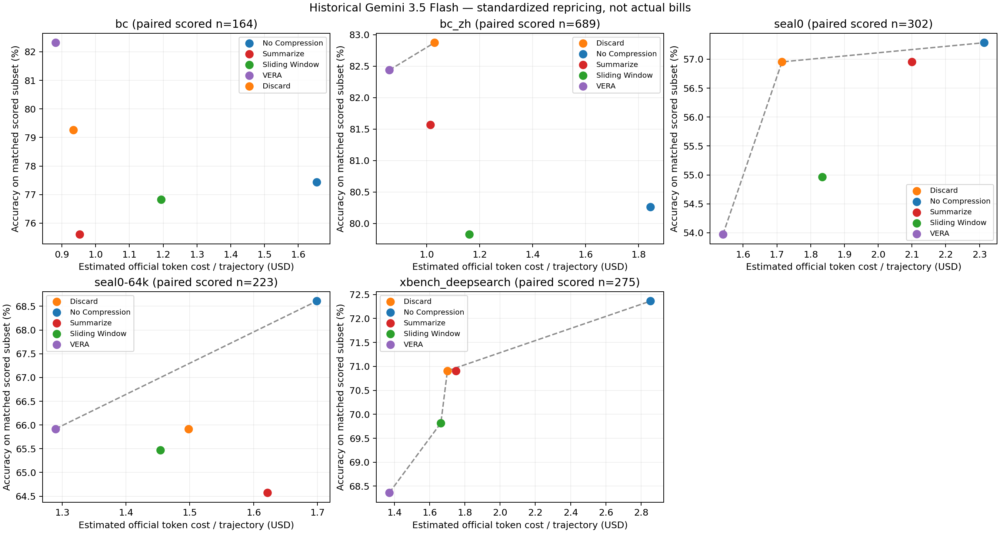
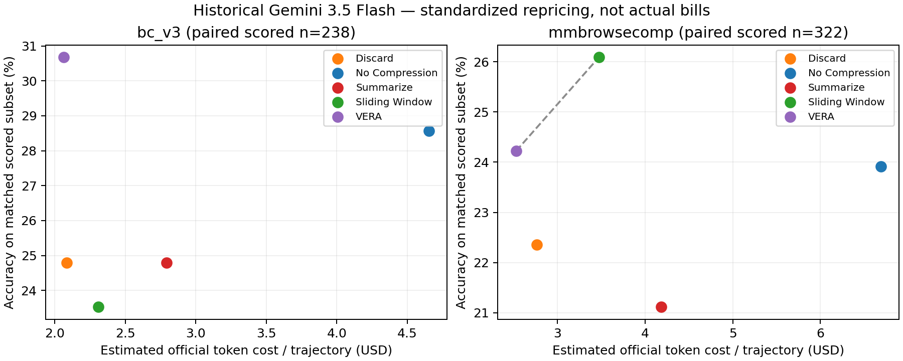

本页为历史 Hermes + `gemini-3.5-flash-thinking` 日志重建结果，未新增 Gemini 推理；不包含尚未完成的 DeepSeek BC-100。

**统计口径**

- 主表与图使用同一集合：每个 benchmark 内，五种方法按“题目内容 + repeat”匹配、且均已有评分的交集。N 是每种方法的匹配运行数，不是独立题目数。仅描述已评分交集，不能直接当作完整 benchmark 的结果。
- Token、成本和延迟均为每个“题目 × 一次运行”的均值；每条匹配轨迹等权。K = 1,000 tokens。重复次数不同的题目不作题目等权平均。Total = cached input + non-cache input + output；表格四舍五入可能造成尾差。
- `$` 是按 2026-11-07 保存的 Google Cloud Standard Global 价格重估的 token 成本，非历史 TokenHub 实付账单。记录的 gateway alias 按名称映射为 Gemini 3.5 Flash，未独立验证实际路由。单价：cached input $0.15/M、non-cache input $1.50/M、output $9/M，output 含 reasoning。不含 Serper、Jina、缓存存储或计算费用。[官方价格来源](https://cloud.google.com/model-garden/pricing)
- 计算式：`estimated_USD = (0.15 × cached + 1.50 × non_cache + 9.00 × output) / 1,000,000`。
- Latency 使用实际进程 end-to-end wall-clock；主表各行的 E2E 覆盖全部 N 条。不能将它视为 provider API latency。历史完整 API 时间仅能恢复部分记录，渲染时间缺失，均不补造。
- 图中每个 benchmark 单独计算 Pareto 前沿：成本更低、准确率更高更优。虚线连接非支配点，不表示可以在两种方法之间连续插值。

**方法 × benchmark 大表**

| Benchmark | 方法 | N | Cached (K) | Non-cache (K) | Output (K) | Total (K) | $ / 题次 | E2E (s) | Acc (%) |
|---|---|---:|---:|---:|---:|---:|---:|---:|---:|
| BrowseComp | No Compression | 164 | 1,210.7 | 926.9 | 9.3 | 2,146.8 | 1.655 | 458.0 | 77.44 |
| BrowseComp | Summarize | 164 | 373.9 | 542.5 | 9.2 | 925.6 | 0.953 | 416.1 | 75.61 |
| BrowseComp | Sliding Window | 164 | 581.6 | 677.3 | 10.0 | 1,268.9 | 1.193 | 497.1 | 76.83 |
| BrowseComp | Discard | 164 | 339.5 | 532.5 | 9.3 | 881.3 | 0.934 | 428.8 | 79.27 |
| BrowseComp | VERA | 164 | 353.5 | 489.0 | 10.5 | 853.0 | 0.881 | 563.3 | 82.32 |
| BrowseComp-zh | No Compression | 689 | 1,246.4 | 1,052.1 | 8.9 | 2,307.4 | 1.845 | 408.7 | 80.26 |
| BrowseComp-zh | Summarize | 689 | 419.5 | 586.2 | 7.9 | 1,013.6 | 1.014 | 363.1 | 81.57 |
| BrowseComp-zh | Sliding Window | 689 | 540.5 | 670.0 | 8.3 | 1,218.8 | 1.161 | 419.1 | 79.83 |
| BrowseComp-zh | Discard | 689 | 435.7 | 574.4 | 11.4 | 1,021.5 | 1.030 | 443.7 | 82.87 |
| BrowseComp-zh | VERA | 689 | 364.7 | 477.9 | 9.8 | 852.3 | 0.859 | 400.5 | 82.44 |
| SEAL-0 | No Compression | 302 | 2,135.9 | 1,253.3 | 12.6 | 3,401.8 | 2.314 | 685.1 | 57.28 |
| SEAL-0 | Summarize | 302 | 962.3 | 1,229.3 | 12.4 | 2,204.0 | 2.100 | 737.5 | 56.95 |
| SEAL-0 | Sliding Window | 302 | 1,029.8 | 1,047.6 | 12.1 | 2,089.5 | 1.834 | 708.8 | 54.97 |
| SEAL-0 | Discard | 302 | 808.7 | 987.2 | 12.6 | 1,808.5 | 1.715 | 717.6 | 56.95 |
| SEAL-0 | VERA | 302 | 861.7 | 856.7 | 14.0 | 1,732.4 | 1.540 | 806.2 | 53.97 |
| SEAL-0 (64k) | No Compression | 223 | 1,371.5 | 934.3 | 10.2 | 2,316.0 | 1.699 | 596.1 | 68.61 |
| SEAL-0 (64k) | Summarize | 223 | 694.0 | 954.3 | 9.5 | 1,657.8 | 1.621 | 684.3 | 64.57 |
| SEAL-0 (64k) | Sliding Window | 223 | 812.7 | 826.0 | 10.3 | 1,649.0 | 1.454 | 673.3 | 65.47 |
| SEAL-0 (64k) | Discard | 223 | 697.8 | 858.3 | 11.7 | 1,567.9 | 1.498 | 744.5 | 65.92 |
| SEAL-0 (64k) | VERA | 223 | 577.1 | 723.7 | 13.1 | 1,313.9 | 1.290 | 761.3 | 65.92 |
| XBench DeepSearch | No Compression | 275 | 1,943.6 | 1,642.7 | 10.9 | 3,597.1 | 2.853 | 700.5 | 72.36 |
| XBench DeepSearch | Summarize | 275 | 653.5 | 1,038.8 | 10.3 | 1,702.6 | 1.749 | 647.3 | 70.91 |
| XBench DeepSearch | Sliding Window | 275 | 688.8 | 979.4 | 10.2 | 1,678.3 | 1.664 | 678.7 | 69.82 |
| XBench DeepSearch | Discard | 275 | 645.7 | 996.9 | 12.1 | 1,654.8 | 1.701 | 746.4 | 70.91 |
| XBench DeepSearch | VERA | 275 | 597.4 | 778.1 | 12.8 | 1,388.3 | 1.372 | 743.3 | 68.36 |
| BC-v3 | No Compression | 238 | 3,559.4 | 2,636.6 | 18.1 | 6,214.1 | 4.652 | 1,423.0 | 28.57 |
| BC-v3 | Summarize | 238 | 1,494.0 | 1,604.7 | 17.8 | 3,116.5 | 2.792 | 1,496.7 | 24.79 |
| BC-v3 | Sliding Window | 238 | 1,496.7 | 1,284.3 | 17.4 | 2,798.4 | 2.308 | 1,490.1 | 23.53 |
| BC-v3 | Discard | 238 | 1,398.2 | 1,106.3 | 23.7 | 2,528.3 | 2.083 | 1,723.2 | 24.79 |
| BC-v3 | VERA | 238 | 1,079.5 | 1,164.2 | 17.3 | 2,261.0 | 2.064 | 1,000.6 | 30.67 |
| MMBrowseComp | No Compression | 322 | 5,280.8 | 3,793.5 | 23.3 | 9,097.7 | 6.692 | 1,621.7 | 23.91 |
| MMBrowseComp | Summarize | 322 | 2,692.3 | 2,402.7 | 19.5 | 5,114.5 | 4.183 | 1,646.5 | 21.12 |
| MMBrowseComp | Sliding Window | 322 | 2,729.2 | 1,919.1 | 20.5 | 4,668.8 | 3.473 | 1,661.4 | 26.09 |
| MMBrowseComp | Discard | 322 | 1,703.3 | 1,570.3 | 17.2 | 3,290.9 | 2.766 | 1,723.1 | 22.36 |
| MMBrowseComp | VERA | 322 | 1,561.8 | 1,427.6 | 17.0 | 3,006.4 | 2.529 | 1,197.6 | 24.22 |

**文本 benchmark：accuracy–cost Pareto 图**

[PDF](pareto_text.pdf)

**多模态 benchmark：accuracy–cost Pareto 图**

[PDF](pareto_multimodal.pdf)

**样本量**

| Benchmark | 匹配运行 N / 方法 | 独立题目数 |
|---|---:|---:|
| BrowseComp | 164 | 95 |
| BrowseComp-zh | 689 | 265 |
| SEAL-0 | 302 | 108 |
| SEAL-0 (64k) | 223 | 93 |
| XBench DeepSearch | 275 | 96 |
| BC-v3 | 238 | 238 |
| MMBrowseComp | 322 | 322 |

**缓存与延迟分解的可恢复范围**

缓存命中率 = 总 cached input / 总 input token，不是逐请求命中率的算术平均。API 耗时是具有完整调用日志的子集上的客户端耗时均值，与 E2E 均值的样本范围不同，不能相减得到渲染开销。压缩次数混合了有证据的记录和明确标记的下界；有效 n 之外的记录未知，不能按零处理。

| Benchmark | 方法 | 模型 token 缓存命中率 (%) | 完整 API 均值 s (有效 n) | 渲染均值 s (有效 n) | 压缩次数均值 (有证据 n) |
|---|---|---:|---:|---:|---:|
| BrowseComp | No Compression | 56.64 | 34.7 (12) | NA (0) | 0.0 (164) |
| BrowseComp | Summarize | 40.80 | 37.3 (16) | NA (0) | 4.2 (9) |
| BrowseComp | Sliding Window | 46.20 | 41.4 (14) | NA (0) | 1.9 (17) |
| BrowseComp | Discard | 38.93 | 39.6 (20) | NA (0) | 1.5 (4) |
| BrowseComp | VERA | 41.96 | 65.5 (15) | NA (0) | 2.5 (64) |
| BrowseComp-zh | No Compression | 54.23 | 40.1 (114) | NA (0) | 0.0 (689) |
| BrowseComp-zh | Summarize | 41.71 | 36.5 (114) | NA (0) | NA (0) |
| BrowseComp-zh | Sliding Window | 44.65 | 41.7 (134) | NA (0) | NA (0) |
| BrowseComp-zh | Discard | 43.13 | 36.0 (115) | NA (0) | NA (0) |
| BrowseComp-zh | VERA | 43.28 | 37.5 (121) | NA (0) | 2.8 (239) |
| SEAL-0 | No Compression | 63.02 | 36.0 (21) | NA (0) | 0.0 (302) |
| SEAL-0 | Summarize | 43.91 | 79.4 (19) | NA (0) | NA (0) |
| SEAL-0 | Sliding Window | 49.57 | 39.5 (19) | NA (0) | NA (0) |
| SEAL-0 | Discard | 45.03 | 33.3 (16) | NA (0) | NA (0) |
| SEAL-0 | VERA | 50.14 | 42.2 (16) | NA (0) | 2.3 (185) |
| SEAL-0 (64k) | No Compression | 59.48 | 40.9 (22) | NA (0) | 0.0 (223) |
| SEAL-0 (64k) | Summarize | 42.10 | 44.4 (21) | NA (0) | NA (0) |
| SEAL-0 (64k) | Sliding Window | 49.59 | 35.8 (17) | NA (0) | NA (0) |
| SEAL-0 (64k) | Discard | 44.84 | 55.1 (18) | NA (0) | NA (0) |
| SEAL-0 (64k) | VERA | 44.37 | 46.6 (24) | NA (0) | 2.0 (111) |
| XBench DeepSearch | No Compression | 54.20 | 36.3 (19) | NA (0) | 0.0 (275) |
| XBench DeepSearch | Summarize | 38.62 | 45.2 (23) | NA (0) | NA (0) |
| XBench DeepSearch | Sliding Window | 41.29 | 43.8 (27) | NA (0) | NA (0) |
| XBench DeepSearch | Discard | 39.31 | 36.9 (23) | NA (0) | NA (0) |
| XBench DeepSearch | VERA | 43.43 | 42.2 (27) | NA (0) | 3.0 (137) |
| BC-v3 | No Compression | 57.45 | 24.9 (2) | NA (0) | 0.0 (238) |
| BC-v3 | Summarize | 48.21 | 27.2 (4) | NA (0) | NA (0) |
| BC-v3 | Sliding Window | 53.82 | 22.5 (3) | NA (0) | NA (0) |
| BC-v3 | Discard | 55.83 | 27.9 (3) | NA (0) | NA (0) |
| BC-v3 | VERA | 48.11 | 28.7 (3) | NA (0) | 3.1 (174) |
| MMBrowseComp | No Compression | 58.20 | 32.7 (1) | NA (0) | 0.0 (322) |
| MMBrowseComp | Summarize | 52.84 | NA (0) | NA (0) | NA (0) |
| MMBrowseComp | Sliding Window | 58.71 | 34.7 (1) | NA (0) | NA (0) |
| MMBrowseComp | Discard | 52.03 | 19.1 (1) | NA (0) | NA (0) |
| MMBrowseComp | VERA | 52.25 | 50.6 (3) | NA (0) | 3.5 (288) |

**覆盖与限制**

全量重建共 22,949 条记录、57 个运行分组，其中 19,238 条可按上述 Gemini 价格重估，22,922 条恢复 E2E，1,322 条恢复完整 API 日志时间。AgenticDataBench 缺 API usage，不能据此产出其可靠成本或放入成本 Pareto 图。缺评分、debug、修改版、消融和其他模型在全量附表中分别保留。

在当前匹配已评分交集内，VERA 的估算 token 成本低于 No Compression；准确率并非所有 benchmark 都更高。这是描述性的成本—准确率取舍，不是显著性结论。

[全量 57 分组 Markdown 附表](experiment1_all_runs.md) · [主表原始 CSV](paired_scored_table.csv) · [全量 CSV](method_benchmark_table.csv) · [审计元数据](audit.json)
