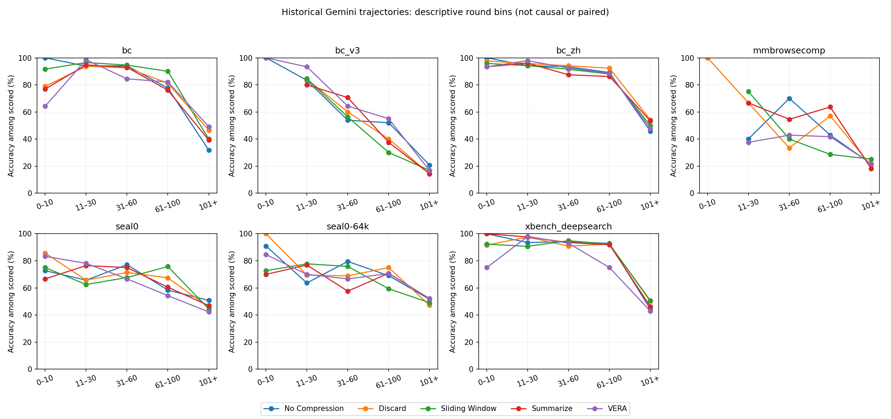

# 实验 5：历史失败与长度分析

离线读取 14,920 条 canonical Gemini 轨迹；没有发起模型调用。读取错误 0 条。历史模型、预算和 campaign 保持分组，未混入新 DeepSeek 实验。

## No Compression 诊断

各诊断为可重叠标签，分母是该组全部轨迹。日志尾部只能证明错误曾出现，不能证明它是最终失败原因；成功重试也可能留下 API 错误。没有匹配字符串不等于没有发生。wrong 是已有评分为 0，缺失评分单独列出，不能当作答错。截断仅由保存的 finish_reason=length/max_tokens 证明，不凭文本猜测。

| Benchmark | N | Context 证据 | 截断证据 | API 错误证据 | 超时 | 答错 | 未评分 |
|---|---:|---:|---:|---:|---:|---:|---:|
| bc | 443 | 0 (0.0%) | 6 (1.4%) | 0 (0.0%) | 0 (0.0%) | 165 (37.2%) | 1 (0.2%) |
| bc_zh | 867 | 0 (0.0%) | 16 (1.8%) | 70 (8.1%) | 0 (0.0%) | 223 (25.7%) | 33 (3.8%) |
| seal0-64k | 333 | 0 (0.0%) | 2 (0.6%) | 17 (5.1%) | 0 (0.0%) | 126 (37.8%) | 15 (4.5%) |
| seal0 | 333 | 0 (0.0%) | 7 (2.1%) | 15 (4.5%) | 0 (0.0%) | 140 (42.0%) | 9 (2.7%) |
| bc_v3 | 300 | 0 (0.0%) | 6 (2.0%) | 1 (0.3%) | 0 (0.0%) | 208 (69.3%) | 12 (4.0%) |
| mmbrowsecomp | 400 | 0 (0.0%) | 14 (3.5%) | 0 (0.0%) | 0 (0.0%) | 297 (74.2%) | 10 (2.5%) |
| xbench_deepsearch | 300 | 0 (0.0%) | 9 (3.0%) | 14 (4.7%) | 0 (0.0%) | 92 (30.7%) | 4 (1.3%) |

## 按轮数分桶

图按各方法自身的实际轨迹轮数分桶，分桶边界事先固定为 0–10 / 11–30 / 31–60 / 61–100 / 101+。这是描述性关联：题目难度、压缩策略、停止条件都会影响轮数，不能解释为 context rot 的因果测量。各桶样本量和未评分数量见 CSV；不能预先声称 No Compression 必然随长度下降。未对这些探索性曲线提供独立样本置信区间，因为同题重复相关。

实测例子：BC 的 No Compression 在 31–60 轮桶准确率为 94.1%（85 条有评分），101+ 轮桶为 31.7%（208 条有评分）。但其他方法也普遍在长轨迹桶下降，不能据此将全部差异归因于 No Compression 的上下文退化。日志中未匹配到明确 context-limit 错误；这不是零发生率的证明。

## VERA 失败样本

从 XBench-DeepSearch、Seal-0 各选最小题号的 10 道不同失败题；有重复时取第一个失败 repeat。以下为可审计的初步归因，无法从“答错”直接证明视觉压缩遗忘。完整题目、reference、输出和证据片段保存于 `outputs/experiment5/cases.json`。

### 1. xbench_deepsearch / 102 / repeat 1

- 问题：请给出 2018-2025 年间在 NIPS 会议上发表的一篇科学论文的标题，该论文的第一作者就读于清华大学，除了第一作者和第五作者之外，其他作者都在一家北京的视频模型初创公司就职。
- Reference：Vidu4D: Single Generated Video to High-Fidelity 4D Reconstruction with Dynamic Gaussian Surfels
- 输出摘录：在 2018-2025 年间在 NIPS (NeurIPS) 会议上发表的满足上述条件的论文标题为：  Identifying and Solving Conditional Image Leakage in Image-to-Video Diffusion Model
- 轮数：68；原文 reference 字符串出现在工具证据中：False；reference 含数字：True。
- 输出对照复核：精确实体/标题选择错误：候选论文标题与reference不同；需验证作者机构约束。
- 初步判断：Reference string absent from available tool text; retrieval gap or answer paraphrase remains possible. No positive compression counter in this export: cannot attribute failure to compression.
- 原始记录：`../hermes-agent/preds_archive/xbench_deepsearch/gemini-3.5-flash-thinking-vis/conv/iter1/102.json`

### 2. xbench_deepsearch / 105 / repeat 1

- 问题：美国西海岸第一间收藏现代艺术的博物馆有一个画廊，由玻璃环绕的桥画廊连接到馆的五楼，这个画廊对外开放的年份的美国总统，与其同个族裔的其他诺贝尔和平奖得主中，最早一位与最晚一位年份之间，共有多少位美国总统赢得了大选？
- Reference：11
- 输出摘录：根据您的题目，我们一步步来解析和计算：  1. **博物馆与画廊的确定**：    - 美国西海岸第一间收藏现代艺术的博物馆是**旧金山现代艺术博物馆（SFMOMA）**。    - 馆内由玻璃环绕的桥画廊连接到五楼并通往屋顶花园（Rooftop Garden）的画廊，是在 **2009年5月10日** 对外开放。  2. **开放年份的美国总统及其族裔**：    - 2009年对外开放时，美国总统是**贝拉克·奥巴马（Barack Obama）**。    - 奥巴马的族裔是**非裔美国人 / 非裔 / 黑人**。  3. **同族裔的其他诺贝尔和平奖得主的最早与最晚一位**：    - **定义一：如果“同个族裔”特指“非裔美国人（African-American）”**：      - 除奥巴马外，其他获得诺贝尔和平奖的非裔美国人仅有两位：        - 最早一位：**拉尔夫·邦奇（Ralph Bunche）**，于 **1950年** 获奖。        - 最晚一位：**小马丁·路德·金（Martin Luther King Jr.）**，于 **1964年** 获奖
- 轮数：222；原文 reference 字符串出现在工具证据中：True；reference 含数字：True。
- 输出对照复核：答案分支选择错误：输出正文出现reference所需的11，但最终选择另一族裔解释给出2/3。
- 初步判断：Reference string occurs in tool evidence; answer selection/retention needs inspection.
- 原始记录：`../hermes-agent/preds_archive/xbench_deepsearch/gemini-3.5-flash-thinking-vis/conv/iter1/105.json`

### 3. xbench_deepsearch / 106 / repeat 1

- 问题：-LKs-在2024年11月的视频中，展示1918年时期，学生春假旅行办法的书籍是什么？
- Reference：《北京高等师范学校周报》
- 输出摘录：(empty)
- 轮数：326；原文 reference 字符串出现在工具证据中：False；reference 含数字：False。
- 输出对照复核：保存的最终输出为空；仅凭此不能判定检索或压缩原因。
- 初步判断：Reference string absent from available tool text; retrieval gap or answer paraphrase remains possible.
- 原始记录：`../hermes-agent/preds_archive/xbench_deepsearch/gemini-3.5-flash-thinking-vis/conv/iter1/106.json`

### 4. xbench_deepsearch / 109 / repeat 2

- 问题：OpenAI 研究员 Yu Zhang 的中文名字是什么
- Reference：张羽
- 输出摘录：OpenAI 研究员 Yu Zhang 的中文名字是**张宇**。
- 轮数：52；原文 reference 字符串出现在工具证据中：False；reference 含数字：False。
- 输出对照复核：精确汉字/实体消歧错误：输出张宇，reference张羽；同音姓名需要精确字符串证据，尚未证明压缩导致。
- 初步判断：Reference string absent from available tool text; retrieval gap or answer paraphrase remains possible. No positive compression counter in this export: cannot attribute failure to compression.
- 原始记录：`../hermes-agent/preds_archive/xbench_deepsearch/gemini-3.5-flash-thinking-vis/conv/iter2/109.json`

### 5. xbench_deepsearch / 111 / repeat 1

- 问题：中国某个城市有不超过15条地铁线路，在不限制换乘次数的情况下，最远的两站之间需要乘坐的最少站数为48站，这是哪个城市？
- Reference：武汉（金台站-葛店南站）
- 输出摘录：这个城市是西安。  在不限制换乘次数的情况下，最远的两站之间需要乘坐的最少站数（即地铁复杂网络的“网络直径”）为48站。根据国内各城市地铁网络特征数据，该城市为西安（截至2021年底，西安地铁运营线路未超过15条，网络直径恰好为48）。
- 轮数：403；原文 reference 字符串出现在工具证据中：False；reference 含数字：False。
- 输出对照复核：城市实体错误：输出西安，reference武汉；可能混用网络统计年份。
- 初步判断：Reference string absent from available tool text; retrieval gap or answer paraphrase remains possible.
- 原始记录：`../hermes-agent/preds_archive/xbench_deepsearch/gemini-3.5-flash-thinking-vis/conv/iter1/111.json`

### 6. xbench_deepsearch / 113 / repeat 1

- 问题：周杰伦于2004年所推出专辑中的第二首歌曲的副歌第一句歌词中的第一个汉字在周杰伦作为歌手发表的所有歌曲中共出现了几次？
- Reference：3次
- 输出摘录：基于已完成的搜索和分析，现将该问题的解答步骤和结论整理如下：  ### 1. 逻辑步骤拆解 * **周杰伦2004年推出的专辑**：周杰伦于2004年8月3日发行的个人第五张国语录音室专辑为**《七里香》**。 * **专辑中的第二首歌曲**：根据《七里香》专辑的官方曲目列表：   1. 《我的地盘》   2. **《七里香》**   3. 《借口》   ...    因此，第二首歌曲为同名主打歌**《七里香》**。 * **副歌第一句歌词**：该歌曲经典副歌段落的第一句为**“雨下整夜我的爱溢出就像雨水”**。 * **副歌第一句歌词中的第一个汉字**：该句的第一个汉字是**“雨”**。  ---  ### 2. “雨”字在周杰伦所有歌曲中出现次数的统计分析 针对“雨”字在周杰伦作为歌手发表的所有歌曲（包含其出道至今的15张个人录音室专辑、多首单曲及EP等）歌词中的出现次数，各大中文大数据与NLP语料库分析给出了以下维度的统计数据：  1. **歌曲覆盖率（词频/意象分布）**：    在针对周杰伦音乐作品（约180余首以歌手身份发表的歌曲）的意象词频统计中，“雨”是他最钟爱的自然意
- 轮数：433；原文 reference 字符串出现在工具证据中：True；reference 含数字：True。
- 输出对照复核：统计口径/事实冲突：输出字频211（并给出37首），reference为3次；需核对题义及语料。
- 初步判断：Reference string occurs in tool evidence; answer selection/retention needs inspection.
- 原始记录：`../hermes-agent/preds_archive/xbench_deepsearch/gemini-3.5-flash-thinking-vis/conv/iter1/113.json`

### 7. xbench_deepsearch / 115 / repeat 1

- 问题：我在2024年12月14日在广州地铁APM线途经站点附近1km内的某场地观看了演唱会，我记得现场大约有2万人，我的座位是1180票面，主席台在我的前面，主舞台在我的正前方偏右侧，我所坐的区域的区号数字是？
- Reference：207区
- 输出摘录：根据您提供的信息和相关场馆、演唱会的资料，解析如下：  ### 1. 演唱会与场馆确认 * **时间与地点**：在2024年12月14日，广州地铁APM线沿线1公里内的场馆举办的约2万人规模的演唱会，为**陶喆《Soul Power II》世界巡回演唱会-广州站**（于2024年12月14日-15日举办）。 * **场馆**：举办场地为**广州海心沙亚运公园**（地铁APM线“海心沙”站直达）。 * **票价与座位类型**：1180元票面为该场演唱会的**看台（最高档看台票）**。  ### 2. 座位区域分析 * **看台布局**：海心沙亚运公园的观众看台位于场地南侧，面向北面的表演广场，看台各分区从西向东进行编号（101区至120区等）。 * **主席台与主舞台位置**：   * **主席台（VIP贵宾席）**位于海心沙看台的正中央最前列。   * 观众描述“**主席台在我的前面**”，说明其座位位于主席台正后方的中央核心看台区域。   * 观众描述“**主舞台在我的正前方偏右侧**”，在看台中央向北望去，主舞台位于前方的偏右位置（偏东侧）。 * **区号确定**：在海心沙看台的中
- 轮数：439；原文 reference 字符串出现在工具证据中：True；reference 含数字：True。
- 输出对照复核：空间证据/座区推断错误：输出108区，reference207区；需现场座位图核验。
- 初步判断：Reference string occurs in tool evidence; answer selection/retention needs inspection.
- 原始记录：`../hermes-agent/preds_archive/xbench_deepsearch/gemini-3.5-flash-thinking-vis/conv/iter1/115.json`

### 8. xbench_deepsearch / 116 / repeat 1

- 问题：在距离大陆超过3000公里的岛屿中，位于最高纬度的岛屿国家公园的门票费用是多少？
- Reference：80
- 输出摘录：3512 km from Chile). Rapa Nui National Park (拉帕努伊国家公园) is a well-known UNESCO World Heritage Site and National Park. Let's
- 轮数：425；原文 reference 字符串出现在工具证据中：True；reference 含数字：True。
- 输出对照复核：输出中断于推理片段，未提供票价；需核对finish reason与运行停止原因。
- 初步判断：Reference string occurs in tool evidence; answer selection/retention needs inspection.
- 原始记录：`../hermes-agent/preds_archive/xbench_deepsearch/gemini-3.5-flash-thinking-vis/conv/iter1/116.json`

### 9. xbench_deepsearch / 119 / repeat 1

- 问题：请找出截至 2024 年 6 月 30 日与 2023 年 6 月 30 日相比，CalSTRS 资产配置中变化最大的三个资产类别，并按从高到低的顺序排序。
- Reference：Real Estate, –2.2 pp; Fixed Income, +1.1 pp; Public Equity, +1.0 pp
- 输出摘录：根据 CalSTRS（加州教师退休基金）发布的截至 2024 年 6 月 30 日的半年度业绩报告（Semi-Annual Performance Report, Period Ending June 30, 2024），在截至 2024 年 6 月 30 日的 12 个月内，与 2023 年 6 月 30 日相比，资产配置中变化最大的三个资产类别及其变化幅度的绝对值，按从高到低的顺序排序如下：  1. **房地产 (Real Estate)**：下降了 **2%**（或 -2%） 2. **全球股票 (Global Equity)**：上升了 **1%**（或 +1%） 3. **固定收益 (Fixed Income / Fixed Incomes)**：上升了 **1%**（或 +1%）  其余资产类别（如私募股权、通胀敏感资产、风险缓解策略、现金等）的变化幅度未达到 1%（或在四舍五入后显示为 0% 变化）。
- 轮数：421；原文 reference 字符串出现在工具证据中：False；reference 含数字：True。
- 输出对照复核：精确数字/排序错误：输出将变化四舍五入为2/1/1，并将股票置于固定收益前；reference要求2.2/1.1/1.0及精确排序。
- 初步判断：Reference string absent from available tool text; retrieval gap or answer paraphrase remains possible.
- 原始记录：`../hermes-agent/preds_archive/xbench_deepsearch/gemini-3.5-flash-thinking-vis/conv/iter1/119.json`

### 10. xbench_deepsearch / 121 / repeat 3

- 问题：《平凡的世界》是中国作家路遥创作的长篇小说（共三册），在第三卷第一章中省委常务副秘书长张生民讲了几句话
- Reference：1
- 输出摘录：在长篇小说《平凡的世界》中，关于省委常务副秘书长张生民在“第三卷（第三部）第一章”中的发言情况，解析如下：  1. **若按原题“第三卷（第三部）第一章”：** 在该章中，张生民**没有说话（讲了0句话）**。 *解析：* 第三部第一章整章是关于煤城“铜城”的地理、历史、煤矿行业以及河南移民等背景的纯叙事与概括性介绍，全章没有任何角色对话或人物登场，结尾为“这就是孙少平要来的地方”。因此，张生民在该章中未出场，发言字数为0。  2. **若题目存在偏差，实际指“第二卷（第二部）第一章”：** 张生民在该章中一共只讲了**一句话（1句话）**。 *原句为：*  > “我寻思你院子里光秃秃的，因此就……”  当时新上任的省委书记乔伯年见张生民在自己小院里移花栽草，便问是谁让搞的，随后张生民咧开嘴难为情地笑着，吐字不清地说了上面这唯一的一句话。
- 轮数：90；原文 reference 字符串出现在工具证据中：True；reference 含数字：True。
- 输出对照复核：题目版本/分支选择冲突：输出同时给出0和另一章节解释下的1；reference为1，最终含歧义。
- 初步判断：Reference string occurs in tool evidence; answer selection/retention needs inspection.
- 原始记录：`../hermes-agent/preds_archive/xbench_deepsearch/gemini-3.5-flash-thinking-vis/conv/iter3/121.json`

### 11. seal0 / q_002 / repeat 3

- 问题：How many NBA players have scored 60 or more points in a regular season game since 2023?
- Reference：12 players
- 输出摘录：Based on NBA regular-season game records since the start of the 2023 calendar year (and including the 2023–24, 2024–25, and 2025–26 seasons), here are the players who have scored 60 or more points in a single regular-season game:  ### **List of Players and Performances:**  1. **Donovan Mitchell** – 71 points (Jan 2, 2023) 2. **Damian Lillard** – 60 points (Jan 25, 2023) and 71 points (Feb 26, 2023) 3. **Giannis Antetokounmpo** – 64 points (Dec 13, 2023) 4. **Joel Embiid** – 70 points (Jan 22, 20
- 轮数：439；原文 reference 字符串出现在工具证据中：False；reference 含数字：True。
- 输出对照复核：时间范围口径冲突：输出按日历年/赛季分别回答13和11，reference为12。
- 初步判断：Reference string absent from available tool text; retrieval gap or answer paraphrase remains possible.
- 原始记录：`../hermes-agent/preds_archive/seal0/gemini-3.5-flash-thinking-vis/conv/iter3/q_002.json`

### 12. seal0 / q_003 / repeat 2

- 问题：What is the most recent film to join the top 10 highest-grossing films of all time?
- Reference：Zootopia 2
- 输出摘录：The most recent film to join the top 10 highest-grossing films of all time is Ne Zha 2 (released on January 29, 2025).   Following its release, the Chinese animated sequel grossed over $2.2 billion worldwide, surpassing "Star Wars: The Force Awakens" to become the 5th highest-grossing film of all time.
- 轮数：128；原文 reference 字符串出现在工具证据中：True；reference 含数字：True。
- 输出对照复核：动态票房榜/实体选择冲突：输出Ne Zha 2，reference Zootopia 2；需核对基准日期。
- 初步判断：Reference string occurs in tool evidence; answer selection/retention needs inspection.
- 原始记录：`../hermes-agent/preds_archive/seal0/gemini-3.5-flash-thinking-vis/conv/iter2/q_003.json`

### 13. seal0 / q_004 / repeat 1

- 问题：What is the current age of the last American experimental physicist to win the Nobel Prize in Physics?
- Reference：83 years old
- 输出摘录：The current age of the last American experimental physicist to win the Nobel Prize in Physics (John M. Martinis, who was born on July 13, 1958, and co-awarded the 2025 Nobel Prize in Physics) as of July 21, 2026, is 68.
- 轮数：156；原文 reference 字符串出现在工具证据中：False；reference 含数字：True。
- 输出对照复核：时间锚点/实体选择冲突：reference 为83岁，输出选择John M. Martinis并按2026年计算68岁；需检查数据集参考日期，不能直接归因压缩。
- 初步判断：Reference string absent from available tool text; retrieval gap or answer paraphrase remains possible.
- 原始记录：`../hermes-agent/preds_archive/seal0/gemini-3.5-flash-thinking-vis/conv/iter1/q_004.json`

### 14. seal0 / q_005 / repeat 2

- 问题：How many airlines are members of IATA, the organization that supports airline activity and helps formulate industry policy and standards?
- Reference：377
- 输出摘录：As of the latest data from the official International Air Transport Association (IATA) member directory, there are 376 airline members.   IATA's official statements also generally describe their membership as representing over 370 airlines in more than 120 countries, which accounts for approximately 85% of total global air traffic.
- 轮数：18；原文 reference 字符串出现在工具证据中：False；reference 含数字：True。
- 输出对照复核：精确计数差1：输出IATA成员376，reference377；目录时间或统计范围需核对。
- 初步判断：Reference string absent from available tool text; retrieval gap or answer paraphrase remains possible. No positive compression counter in this export: cannot attribute failure to compression.
- 原始记录：`../hermes-agent/preds_archive/seal0/gemini-3.5-flash-thinking-vis/conv/iter2/q_005.json`

### 15. seal0 / q_006 / repeat 1

- 问题：How many books has Jamie Oliver published since 2020?
- Reference：8
- 输出摘录：call:default_api:execute_code{code:# Let's list the known Jamie Oliver books published since 2020 (i.e. >= 2020) and verify their release dates carefully.  books = [     {"title": "7 Ways: Easy Ideas for Every Day of the Week", "year": 2020, "pub_date": "August 2020 (UK) / November 2020 (US)"},     {"title": "Together: Memorable Meals Made Easy", "year": 2021, "pub_date": "September 2021"},     {"title": "ONE: Simple One-Pan Wonders", "year": 2022, "pub_date": "September 2022"},     {"title": "B
- 轮数：282；原文 reference 字符串出现在工具证据中：True；reference 含数字：True。
- 输出对照复核：输出末尾仍是书目统计代码/工具调用样式，未形成清晰最终数字；需区分输出结束机制与事实遗忘。
- 初步判断：Reference string occurs in tool evidence; answer selection/retention needs inspection.
- 原始记录：`../hermes-agent/preds_archive/seal0/gemini-3.5-flash-thinking-vis/conv/iter1/q_006.json`

### 16. seal0 / q_009 / repeat 2

- 问题：How many versions of the .NET platform have been released that have a support lifetime of more than 12 months?
- Reference：11
- 输出摘录：Based on the official support policy and release history of the .NET platform (including .NET Core and .NET 5+), there have been **10** versions released that have a support lifetime of more than 12 months:  1. **.NET Core 1.0**: ~36 months (June 2016 – June 2019) 2. **.NET Core 1.1**: ~31 months (November 2016 – June 2019) 3. **.NET Core 2.0**: ~13.5 months (August 2017 – October 2018) 4. **.NET Core 2.1**: ~38 months (May 2018 – August 2021) 5. **.NET Core 2.2**: ~12.5 months (December 2018 –
- 轮数：220；原文 reference 字符串出现在工具证据中：True；reference 含数字：True。
- 输出对照复核：版本枚举/支持周期筛选差异：输出10个版本，reference11；需逐项检查遗漏。
- 初步判断：Reference string occurs in tool evidence; answer selection/retention needs inspection.
- 原始记录：`../hermes-agent/preds_archive/seal0/gemini-3.5-flash-thinking-vis/conv/iter2/q_009.json`

### 17. seal0 / q_010 / repeat 1

- 问题：How many YouTube music videos have surpassed 7 billion views?
- Reference：6
- 输出摘录：Based on the most up-to-date data for the most-viewed YouTube videos as of mid-2026, there are exactly **2** music videos that have surpassed 7 billion views:  1. **"Despacito"** by Luis Fonsi featuring Daddy Yankee (approx. 9.07 billion views) 2. **"See You Again"** by Wiz Khalifa featuring Charlie Puth (approx. 7.03 billion views)  Other videos exceeding 7 billion views (such as *Baby Shark Dance*, *Wheels on the Bus*, *Bath Song*, *Johny Johny Yes Papa*, and *Phonics Song with TWO Words*) are
- 轮数：421；原文 reference 字符串出现在工具证据中：True；reference 含数字：True。
- 输出对照复核：类别口径冲突：输出明确排除儿歌/教育视频后回答2，而reference为6。
- 初步判断：Reference string occurs in tool evidence; answer selection/retention needs inspection.
- 原始记录：`../hermes-agent/preds_archive/seal0/gemini-3.5-flash-thinking-vis/conv/iter1/q_010.json`

### 18. seal0 / q_012 / repeat 2

- 问题：Among the 50 most-liked Instagram posts, how many were made by Cristiano Ronaldo’s account and received over 32 million likes?
- Reference：4
- 输出摘录：Based on the most up-to-date data for the most-liked Instagram posts, there are **5** posts made by Cristiano Ronaldo's account (`@cristiano`) that are within the top 50 most-liked posts and received over 32 million likes:  1. **Lionel Messi and Cristiano Ronaldo playing chess** (Louis Vuitton advertisement) – **41.1 million likes** (posted November 19, 2022) 2. **Taking an icy dip in snowy Lapland, Finland** – **35.2 million likes** (posted December 24, 2024) 3. **Announcement of joining Al-Nas
- 轮数：427；原文 reference 字符串出现在工具证据中：True；reference 含数字：True。
- 输出对照复核：动态点赞阈值计数差异：输出5，reference4；需核对抓取时间。
- 初步判断：Reference string occurs in tool evidence; answer selection/retention needs inspection.
- 原始记录：`../hermes-agent/preds_archive/seal0/gemini-3.5-flash-thinking-vis/conv/iter2/q_012.json`

### 19. seal0 / q_014 / repeat 3

- 问题：How many of the top 50 most-followed Instagram accounts belong to individuals or entities based in the United States?
- Reference：29
- 输出摘录：Based on the rankings of the top 50 most-followed Instagram accounts, here is the breakdown of those belonging to individuals or entities based in the United States:  ### Analysis of the Top 50 Accounts: * **Entities/Brands based in the US (4):** Instagram, National Geographic, NASA, Nike. * **Individuals based in the US (31):** Selena Gomez, Kylie Jenner, Dwayne Johnson, Ariana Grande, Kim Kardashian, Beyoncé, Khloé Kardashian, Kendall Jenner, Taylor Swift, Jennifer Lopez, Nicki Minaj (born in
- 轮数：425；原文 reference 字符串出现在工具证据中：True；reference 含数字：True。
- 输出对照复核：国籍/居住地分类差异：输出35或33，reference29；答案自身明确采用不同分类口径。
- 初步判断：Reference string occurs in tool evidence; answer selection/retention needs inspection.
- 原始记录：`../hermes-agent/preds_archive/seal0/gemini-3.5-flash-thinking-vis/conv/iter3/q_014.json`

### 20. seal0 / q_015 / repeat 2

- 问题：How many of the top 30 most-liked YouTube videos belong to MrBeast?
- Reference：9
- 输出摘录：Based on the current ranking of the most-liked YouTube videos (as documented on Wikipedia and tracking platforms), there are **5** videos belonging to MrBeast in the top 30:  1. **"Would You Fly to Paris for a Baguette?"** 2. **"Giving iPhones Instead Of Candy on Halloween"** 3. **"Katana Vs Bullet"** 4. **"The Rock Vs MrBeast For $100,000"** 5. **"Make This Video The Most Liked Video On Youtube"**  **Final Answer:** 5
- 轮数：421；原文 reference 字符串出现在工具证据中：True；reference 含数字：True。
- 输出对照复核：视频列表计数缺项或阈值时间差异：输出5项，reference9；需核对完整候选列表。
- 初步判断：Reference string occurs in tool evidence; answer selection/retention needs inspection.
- 原始记录：`../hermes-agent/preds_archive/seal0/gemini-3.5-flash-thinking-vis/conv/iter2/q_015.json`

## 相关工作与论文修改

[DeepSeek-V3.2 §4.4](https://arxiv.org/html/2512.02556v1#S4.SS4) 在超过上下文窗口 80% 时触发管理；Discard-all 删除此前工具调用历史，BrowseComp 得到 67.6。其设置说明丢弃历史可通过允许更多执行步骤改善表现，不能直接证明本实验排序具有同一原因。
[Context Rot（Chroma 原始报告）](https://www.trychroma.com/research/context-rot) 研究输入长度增加时的性能变化；[Lost in the Middle](https://arxiv.org/abs/2307.03172) 展示相关信息位置影响模型使用长上下文的能力。两者提供机制假说，不替代这里的受控实验。

建议将 Finding 3 改写为“在本实验预算和数据集下观察到的趋势”。“统计上持平，且成本更低”仍需对应实验 4 的配对分析和实验 1 的同题成本证据；不显著不等于已证明等效。当前未修改论文主文件。
