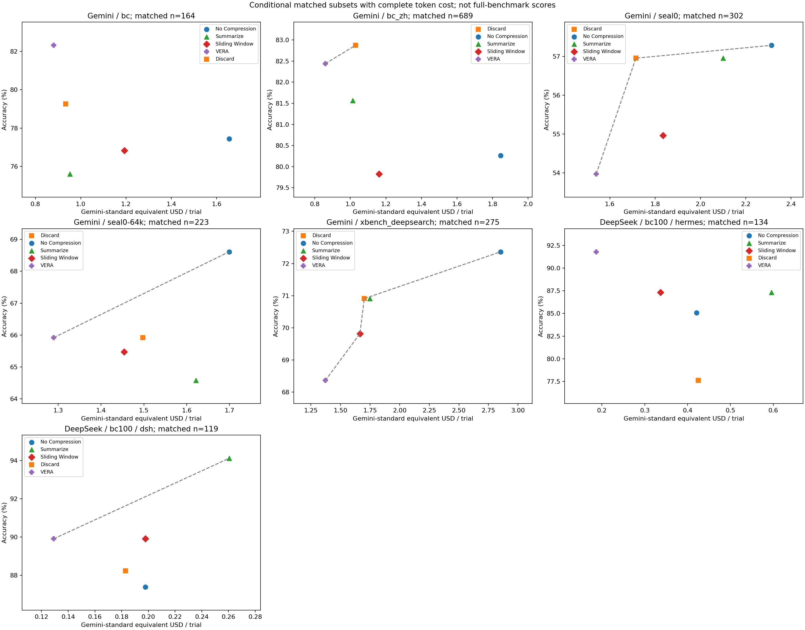
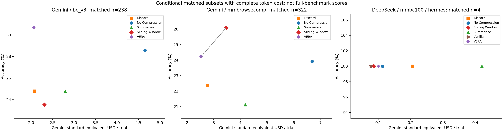

# Rebuttal 实验结果总入口（2026-11-12）

本目录归档当前能核实的**全部已规划实验的结果与缺口**，不将运行中任务描述为完成。最新预测/评分快照时间见[当前代次结果](current-generations.md)；运行状态见[调度快照](runtime-snapshot.md)。历史统计冻结于 **2026-11-12 10:43 UTC+8**，与随后V10/V11/V12的新运行分开列示。各资源统计的采集时间独立标注；这不是实时看板。

## 结果与文件

|项目|已归档内容|目前可用于回复的范围|
|---|---|---|
|多 model / harness：BC|[历史全部策略 mean±std、超时数量、配对检验](summary.md)；[新代次终态和评分](current-generations.md)|历史有效结果可报告；不齐的分母属于条件子集。DSH视觉新恢复仍有本地准备故障，不能称完整新版本验证。|
|MMBC：DeepSeek＋Hermes 六方法|同上；[普通策略797个超时来源诊断](mmbc-timeout-diagnosis.md)|VERA、vanilla及普通策略仍有缺失、超时和新结果待评分，尚不能据当前小样本确立“VERA优于所有方法”。|
|实验1：成本、缓存、延迟|[历史方法×benchmark大表](historical_cost_pareto.md)、[DeepSeek同题成本大表](deepseek_paired_cost.md)、[历史全部恢复消耗](deepseek_cost_summary.md)、[V10/V11/V12已知token小计](current-token-usage.md)|可报告已观测token、缓存、统一价格假设下的重估和端到端耗时；历史API/渲染计量不完整，缺失为NA。|
|实验3：Summarization / Sliding Window＋Native Images|[受控结果与预算匹配](controlled-information-loss.md)、[V8/V9补充](controlled-v8-v9.md)|有效三臂配对样本过少；新正式队列缺预算目标/依赖阻塞，不能宣称受控实验已证明优势。本轮V12不含该实验。|
|实验4：方差与显著性|[历史mean±std及配对检验](summary.md)、[每方法bootstrap95% CI](method_mean_bootstrap95.csv)、[Table 1来源审计](../../paper-table1/audit.md)|不追加avg4。已有avg3的可用子集统计可报告，但不显著不等于等效；原表来源仍需核对。|
|RQ3：七档分辨率100×3|[当前代次及去重统计](current-generations.md)、[历史分辨率统计](summary.md)|0、0.25、0.5、0.7、0.75、0.8、1.0。新结果尚未齐、仍有评分积压，保留每档有效分母，不把pending记0。|
|实验5：反直觉排序与失败原因|[14,920条历史轨迹、按轮数分桶及20个失败case](../../experiment5/experiment5.md)|可作为描述性分析；不能把所有差异归因为context rot，也不能把缺日志解释成无错误。|
|实验6：信息损失|[Probe QA、重建、按距离曲线及覆盖率](controlled-information-loss.md)|视觉重建语义评分仍缺；五臂共同可评QA只有极小样本，不能声称完整分辨率/时间衰减曲线。本轮V12不含该实验。|
|可选cache-aware VERA|尚无独立效果实验|已有缓存记录不等于完成cache-aware变体评测。|
|AST / GUI扩展展示|尚无完整新实验|未列作已完成结果。AgenticDataBench按用户要求不补测。|

## 成本—准确率 Pareto 图

图为10:43历史冻结快照，使用每个benchmark/model/harness内所有方法共同可评分、且费用可观测的题次。**DeepSeek MMBC该交集仅4题次，不能支持整体排名。** 图不是V12最新结果。

文本任务：[PNG](pareto_text.png) / [PDF](pareto_text.pdf)。

多模态任务：[PNG](pareto_multimodal.png) / [PDF](pareto_multimodal.pdf)。

历史RQ3条件mean±std：[PNG](rq3_mean_std.png) / [PDF](rq3_mean_std.pdf)。信息损失按距离的已观测曲线：[PNG](information-loss-age-curves.png) / [CSV](information-loss-age-curves.csv)。缺失点不补零；图不能证明平滑衰减。

## 统计口径

- 科学单位是题目×repeat×方法；重试不是新seed，不把不同代次题次相加扩充样本。
- 正常完成的答案全部保留，包括答错；不按答案正确性挑轨迹。
- 明确系统/provider/网络故障单列；明确实际轮数、输出或context预算耗尽才记任务失败0。原因不明timeout、待评分、未执行、缺档分别保留，不凭超时标签推断原因。
- mean±std是三个repeat准确率的均值与样本标准差（ddof=1）。分母不齐时必须注明条件结果；未齐不能写成完整100×3准确率。配对bootstrap按题簇处理相关重复。
- 延迟分清端到端、客户端HTTP、渲染。客户端HTTP等待不是provider内部计算时间，也不能通过E2E减API填补渲染计量。
- Cached/non-cache/output来自原始usage；缺失不补0。模型token缓存与搜索/fetch缓存是不同指标。
- 费用表沿用归档报告中明确列出的Gemini等价单价假设，非DeepSeek/TokenHub实付，且不含未观测用量、工具和算力。此次文档发布没有重新核价。
- V12为每次3600秒、原生agent上限500轮、累计最多3次尝试（首次加最多2次timeout重试），继承本轮V10/V11次数。普通failed不重派。已有旧轮数配置下的结果保留原标签，不能称全部结果均以500轮运行。

## 必须保留的限制

Table 1候选审计重建了59.8%的BC指纹，但发现原cohort按四个压缩方法成功筛选、且No Compression有41条缺失被旧计算补零；全表69.0%的来源尚未匹配。不能将该候选直接宣布为最终Table 1，也不能继续把缺失当成已证实答错。[完整审计](../../paper-table1/audit.md)。

旧受控实验有预算匹配失败；局部控制通过或校准成功不等于正式三臂配对完成。信息损失中的重建0/0表示不可评价，不是0%语义召回。详见各专项表。

## 下载与来源

- [历史策略汇总CSV](summary.csv)、[bootstrap CI CSV](method_mean_bootstrap95.csv)
- [全部历史成本组CSV](historical_all_groups.csv)、[共同题次成本CSV](historical_paired.csv)、[DeepSeek共同题次成本CSV](deepseek_paired_cost.csv)
- [受控摘要CSV](controlled-summary.csv)、[V8/V9受控CSV](controlled-v8-v9-summary.csv)、[信息损失摘要CSV](information-loss-summary.csv)
- [新代次token聚合JSON](current-token-usage.json)、[调度聚合JSON](runtime-snapshot.json)、[VERA分阶段时延诊断JSON](vera-transport-diagnostic.json)
- [归档来源SHA与时间](source-manifest.json)

本目录只发布汇总、图表和来源校验信息，不发布凭据、原始请求/响应、题干或标准答案。未新增推理或评分调用。
