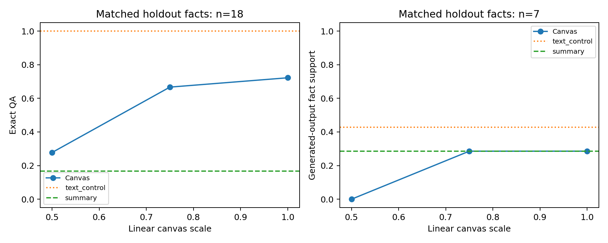
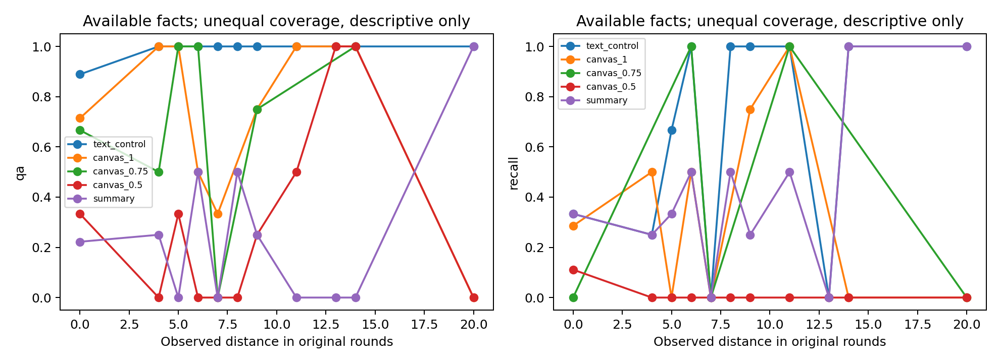

# 信息损失：单次恢复轮最终结果

本轮已结束；冻结于 2026-11-13 20:34 UTC。仅复用既有完成阶段并补发此前未执行的阶段，超时不重发。新内联无损编码发出 56 次请求：50 completed、6 ReadTimeout；与旧 V14 的 25 次合计 81/90 次阶段调用。90 是上限，先决阶段失败后不会补造下游 judge 请求。

9 条固定 BC holdout 轨迹，排除开发题 q004；各尺度均来自真实完整 canvas。以下是五种方法共同可评事实上的配对描述，QA 为 18 个事实、语义重建为 7 个事实，均不是独立 18/7 道 benchmark 题。11月14日按机器可读报告更正正文分母，与下表一致。

|表示|共同 Probe QA|共同重建事实支持|完整重建 / 有返回的条件|
|---|---:|---:|---:|
|完整原文本|18/18|3/7|9/9|
|Canvas 1.0×|13/18|2/7|1/9|
|Canvas 0.75×|12/18|2/7|1/9|
|Canvas 0.5×|5/18|0/7|0/9|
|600-word 摘要|3/18|2/7|9/9|

本样本中，降低分辨率伴随更低的 QA 正确率；canvas 的共同 QA 高于摘要，但低于完整原文。不能据这 18 个可评事实宣称总体显著优势。完整视觉重建成功很少，部分输出的事实支持率不代表完成了完整重建；不能写成“视觉表示基本无损”。

限制：原文本对照不是论文历史 Text-only Rendering 消融；600-word 摘要与图像没有匹配 token 预算。来源是 BC 文本历史，因此不是 MMBC 泛化实验。历史距离曲线的各方法覆盖不同，仅作描述性关联；无法证明随时间平滑衰减。事实提取与语义 judge 使用同一 DeepSeek 系列，尚无独立人工复核；标准化 span-judge 与旧 quote-judge 不混合。

新轮有已知用量的 50 次请求合计 input 311,300、cached input 0、non-cache input 311,300、output 87,484、total 398,784 tokens。另 6 次缺用量，以上不是全轮总账。provider 内部耗时和实际美元账单不可得，客户端 HTTP 时间不能代替它们。

[逐方法覆盖与用量 JSON](information-loss-v15-report.json) · [CSV](information-loss-v15-summary.csv) · [距离分桶 CSV](information-loss-v15-observed-age.csv)。
