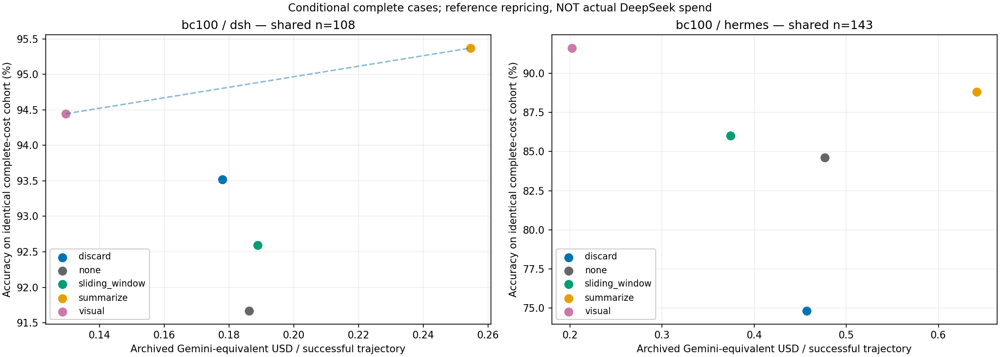
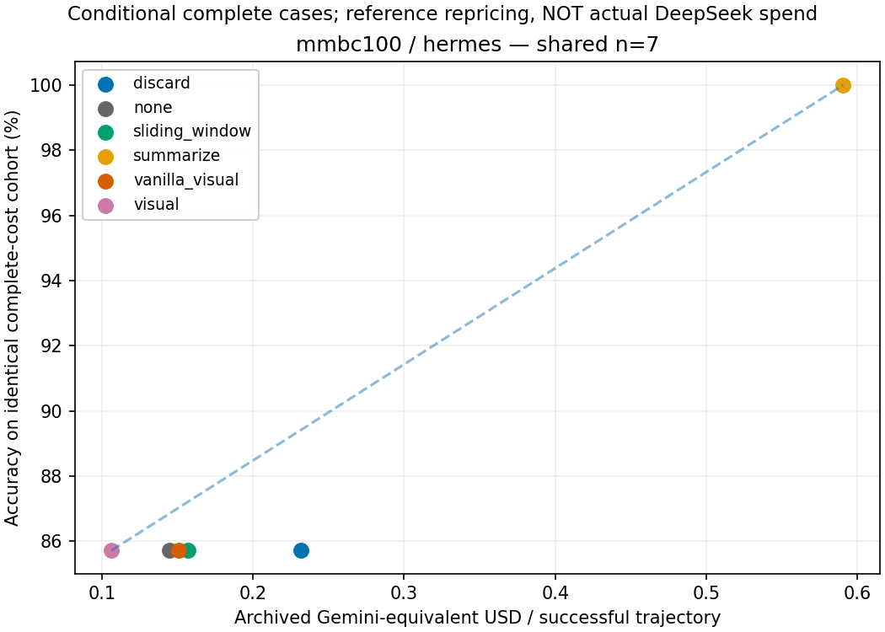
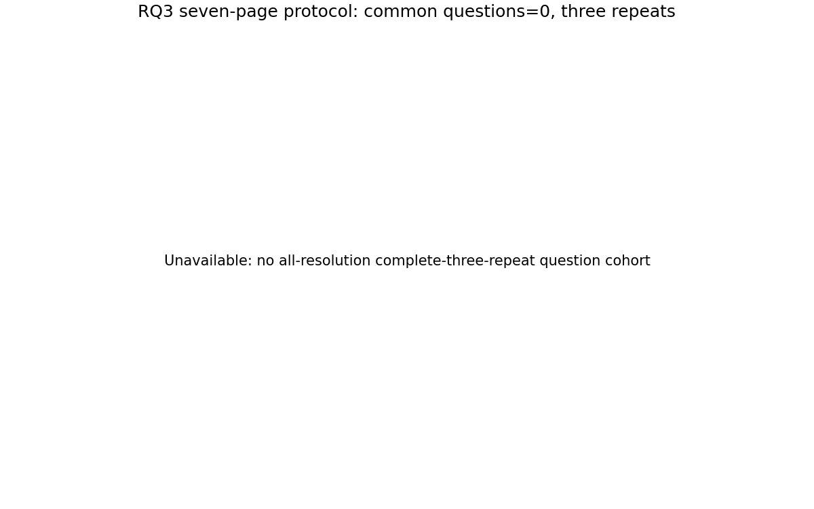

# 单次补跑进度

更新时间：2026-11-13T20:33:24.260617+00:00；截止：2026-11-14T19:20:06Z。

保留最早合法完成结果，不按正确性择优。RQ3仅使用七页V10及后继协议。均值±标准差来自三个repeat已有评分的完成题次；分母不足300时不是完整avg@3。

|Benchmark|Harness|方法|完成/300|已评分|每repeat分母|mean ± std (%)|在途|待跑|超时|其他失败|
|---|---|---|---:|---:|---|---:|---:|---:|---:|---:|
|bc100|dsh|discard|194|194|65/62/67|93.28 ± 2.39|31|72|2|1|
|bc100|dsh|none|236|236|84/72/80|90.23 ± 1.46|16|44|4|0|
|bc100|dsh|sliding_window|236|236|84/73/79|94.05 ± 0.89|16|42|3|3|
|bc100|dsh|summarize|230|229|82/72/75|93.93 ± 1.09|20|46|3|1|
|bc100|dsh|visual|209|209|78/70/61|91.90 ± 0.92|24|47|16|4|
|bc100|hermes|discard|294|294|98/99/97|65.63 ± 2.91|2|0|0|4|
|bc100|hermes|none|299|299|99/100/100|76.27 ± 3.10|0|0|0|1|
|bc100|hermes|sliding_window|299|299|100/100/99|73.92 ± 1.66|1|0|0|0|
|bc100|hermes|summarize|297|297|100/100/97|81.16 ± 1.88|3|0|0|0|
|bc100|hermes|visual|264|264|90/86/88|89.80 ± 2.80|16|20|0|0|
|mmbc100|hermes|discard|129|129|47/44/38|49.97 ± 6.65|48|109|14|0|
|mmbc100|hermes|none|128|127|46/42/39|82.79 ± 2.14|47|111|14|0|
|mmbc100|hermes|sliding_window|149|149|56/52/41|81.56 ± 3.10|44|95|12|0|
|mmbc100|hermes|summarize|111|104|40/36/28|82.95 ± 8.28|48|126|15|0|
|mmbc100|hermes|vanilla_visual|138|136|57/42/37|75.29 ± 2.67|48|98|16|0|
|mmbc100|hermes|visual|146|143|65/45/33|81.08 ± 2.98|37|96|21|0|
|rq3|hermes|scale_0.0|278|273|90/89/94|78.40 ± 1.39|16|5|0|1|
|rq3|hermes|scale_0.25|232|224|76/76/72|79.53 ± 3.55|25|43|0|0|
|rq3|hermes|scale_0.5|160|142|42/49/51|90.10 ± 5.12|47|91|0|2|
|rq3|hermes|scale_0.7|139|132|48/39/45|93.02 ± 2.97|48|109|4|0|
|rq3|hermes|scale_0.75|158|142|43/52/47|90.93 ± 2.59|46|95|1|0|
|rq3|hermes|scale_0.8|130|122|41/43/38|92.54 ± 2.86|48|112|10|0|
|rq3|hermes|scale_1.0|181|175|61/59/55|82.26 ± 3.63|32|87|0|0|

仅明确任务预算耗尽的附加零分统计保存在JSON的task_valid；系统失败和未知原因超时不补0。

重复执行告警：0槽。读取异常：0条。

新轮成本与延迟仅引用现有聚合：历史成本保留在原账本，未在此表重复累加。NA表示未测量或无法确认，不等于0。

|Benchmark/Harness/方法|cached input|non-cache input|output|total|未知usage请求|E2E均值(秒，已终态)|API客户端秒|渲染秒|USD|
|---|---:|---:|---:|---:|---:|---:|---:|---:|---:|
|bc100/dsh/discard|≥2083328（不完整）|≥813057（不完整）|≥230946（不完整）|≥3127331（不完整）|7|1156.1|NA|NA|NA|
|bc100/dsh/none|≥1131008（不完整）|≥439335（不完整）|≥123097（不完整）|≥1693440（不完整）|2|NA|NA|NA|NA|
|bc100/dsh/sliding_window|≥722944（不完整）|≥339205（不完整）|≥117632（不完整）|≥1179781（不完整）|0|841.6|NA|NA|NA|
|bc100/dsh/summarize|≥1961472（不完整）|≥941760（不完整）|≥199666（不完整）|≥3102898（不完整）|9|1276.7|NA|NA|NA|
|bc100/dsh/visual|≥2953600（不完整）|≥1013095（不完整）|≥252879（不完整）|≥4219574（不完整）|11|254.4|NA|NA|NA|
|bc100/hermes/discard|≥3864448（不完整）|≥1171958（不完整）|≥793563（不完整）|≥5829969（不完整）|8|1024.4|NA|NA|NA|
|bc100/hermes/none|327040|124510|78979|530529|0|793.7|NA|NA|NA|
|bc100/hermes/sliding_window|≥1130368（不完整）|≥447593（不完整）|≥107682（不完整）|≥1685643（不完整）|1|NA|NA|NA|NA|
|bc100/hermes/summarize|≥2294144（不完整）|≥6436961（不完整）|≥614352（不完整）|≥9345457（不完整）|12|826.1|NA|NA|NA|
|bc100/hermes/visual|≥5453952（不完整）|≥1799968（不完整）|≥397746（不完整）|≥7651666（不完整）|35|1095.0|NA|NA|NA|
|mmbc100/hermes/discard|≥11218688（不完整）|≥3814400（不完整）|≥1082333（不完整）|≥16115421（不完整）|134|632.5|NA|NA|NA|
|mmbc100/hermes/none|≥30655360（不完整）|≥4835748（不完整）|≥615185（不完整）|≥36106293（不完整）|145|871.2|NA|NA|NA|
|mmbc100/hermes/sliding_window|≥15295488（不完整）|≥6063877（不完整）|≥647227（不完整）|≥22006592（不完整）|125|498.7|NA|NA|NA|
|mmbc100/hermes/summarize|≥8754176（不完整）|≥14741564（不完整）|≥1815223（不完整）|≥25310963（不完整）|133|1010.6|NA|NA|NA|
|mmbc100/hermes/vanilla_visual|≥7620096（不完整）|≥2944449（不完整）|≥459916（不完整）|≥11024461（不完整）|118|1479.4|NA|NA|NA|
|mmbc100/hermes/visual|≥4609408（不完整）|≥1852984（不完整）|≥371721（不完整）|≥6834113（不完整）|93|460.0|NA|NA|NA|
|rq3/hermes/scale_0.0|≥8404864（不完整）|≥2977909（不完整）|≥668684（不完整）|≥12051457（不完整）|25|615.2|NA|NA|NA|
|rq3/hermes/scale_0.25|≥9997440（不完整）|≥3094386（不完整）|≥768827（不完整）|≥13860653（不完整）|39|356.1|NA|NA|NA|
|rq3/hermes/scale_0.5|≥12392064（不完整）|≥4877709（不完整）|≥961994（不完整）|≥18231767（不完整）|75|412.6|NA|NA|NA|
|rq3/hermes/scale_0.7|≥9302912（不完整）|≥3295869（不完整）|≥831395（不完整）|≥13430176（不完整）|100|292.2|NA|NA|NA|
|rq3/hermes/scale_0.75|≥11795840（不完整）|≥3780794（不完整）|≥864006（不完整）|≥16440640（不完整）|81|523.5|NA|NA|NA|
|rq3/hermes/scale_0.8|≥9578112（不完整）|≥3046606（不完整）|≥820800（不完整）|≥13445518（不完整）|111|449.6|NA|NA|NA|
|rq3/hermes/scale_1.0|≥8643712（不完整）|≥2902431（不完整）|≥578258（不完整）|≥12124401（不完整）|45|412.6|NA|NA|NA|

## 完整三次与配对统计

以下主表使用每个benchmark/harness的**所有方法、同题、三个repeat均完成且已评分**交集。N不足100时是条件完整案例，不是全量100×3。CI按题簇bootstrap；不显著不能解释为等价。

|Benchmark|Harness|方法|共同题数|mean ± sample std (%)|题簇95%CI (%)|
|---|---|---|---:|---:|---|
|bc100|dsh|discard|37|92.793 ± 1.560|[83.784, 100.000]|
|bc100|dsh|none|37|90.991 ± 1.560|[81.081, 99.099]|
|bc100|dsh|sliding_window|37|91.892 ± 2.703|[82.883, 99.099]|
|bc100|dsh|summarize|37|91.892 ± 2.703|[83.784, 98.198]|
|bc100|dsh|visual|37|92.793 ± 1.560|[83.784, 100.000]|
|bc100|hermes|discard|80|76.667 ± 2.602|[68.750, 84.167]|
|bc100|hermes|none|80|85.000 ± 2.500|[78.750, 90.833]|
|bc100|hermes|sliding_window|80|85.417 ± 1.909|[79.167, 91.250]|
|bc100|hermes|summarize|80|88.333 ± 1.443|[82.500, 93.333]|
|bc100|hermes|visual|80|92.500 ± 1.250|[87.083, 97.083]|
|mmbc100|hermes|discard|5|60.000 ± 0.000|[20.000, 100.000]|
|mmbc100|hermes|none|5|93.333 ± 11.547|[80.000, 100.000]|
|mmbc100|hermes|sliding_window|5|66.667 ± 11.547|[26.667, 100.000]|
|mmbc100|hermes|summarize|5|86.667 ± 11.547|[73.333, 100.000]|
|mmbc100|hermes|vanilla_visual|5|73.333 ± 11.547|[33.333, 100.000]|
|mmbc100|hermes|visual|5|73.333 ± 11.547|[33.333, 100.000]|
|rq3|hermes|scale_0.0|0|NA ± NA|[NA, NA]|
|rq3|hermes|scale_0.25|0|NA ± NA|[NA, NA]|
|rq3|hermes|scale_0.5|0|NA ± NA|[NA, NA]|
|rq3|hermes|scale_0.7|0|NA ± NA|[NA, NA]|
|rq3|hermes|scale_0.75|0|NA ± NA|[NA, NA]|
|rq3|hermes|scale_0.8|0|NA ± NA|[NA, NA]|
|rq3|hermes|scale_1.0|0|NA ± NA|[NA, NA]|

配对检验每一对都保留同题全部3次，但不同配对可能有不同题集；不能将其拼成单一方法排名。Holm跨下表全部有效比较校正。中间快照仅供监测，不能用反复查看p值决定停止。

|Benchmark/Harness|对比|配对题簇|Δ(pp)|95%CI(pp)|p(Holm)|
|---|---|---:|---:|---|---:|
|bc100/dsh|visual − discard|46|0.000|[-2.174, 2.174]|1|
|bc100/dsh|visual − none|48|1.389|[0.000, 3.472]|1|
|bc100/dsh|visual − sliding_window|48|0.694|[-1.389, 2.778]|1|
|bc100/dsh|visual − summarize|50|0.667|[-3.333, 4.667]|1|
|bc100/hermes|visual − discard|80|15.833|[9.583, 22.500]|0.0019|
|bc100/hermes|visual − none|82|7.724|[3.252, 12.602]|0.036|
|bc100/hermes|visual − sliding_window|81|7.407|[2.469, 12.757]|0.07989|
|bc100/hermes|visual − summarize|82|4.472|[1.220, 7.724]|0.2496|
|mmbc100/hermes|visual − discard|14|16.667|[2.381, 33.333]|1|
|mmbc100/hermes|visual − none|14|0.000|[-14.286, 11.905]|1|
|mmbc100/hermes|visual − sliding_window|15|4.444|[-4.444, 15.556]|1|
|mmbc100/hermes|visual − summarize|8|-8.333|[-37.500, 12.500]|1|
|mmbc100/hermes|visual − vanilla_visual|13|-7.692|[-25.641, 5.128]|1|
|rq3/hermes|scale_1.0 − scale_0.0|22|1.515|[-3.030, 6.061]|1|
|rq3/hermes|scale_1.0 − scale_0.25|15|4.444|[0.000, 11.111]|1|
|rq3/hermes|scale_1.0 − scale_0.5|3|0.000|[0.000, 0.000]|1|
|rq3/hermes|scale_1.0 − scale_0.7|3|-11.111|[-33.333, 0.000]|1|
|rq3/hermes|scale_1.0 − scale_0.75|5|6.667|[0.000, 20.000]|1|
|rq3/hermes|scale_1.0 − scale_0.8|2|0.000|[0.000, 0.000]|1|

## 同题成本、缓存与延迟

仅使用所有方法同时完成、已评分且成功native轨迹usage完整的相同题次，同时计算两个坐标。参考价沿用归档：cached $0.15/M、non-cache $1.50/M、output $9/M；不是实际DeepSeek账单，未重核今日价格。早期失败重试费用保存在原账本，不混入以下成功轨迹效率指标。BC/MMBC接受历史协议混合，结果仅作条件比较。

|Benchmark/Harness|方法|共同N|cached|non-cache|output|total|参考$/题次|Acc%|token cache%|API客户端秒|render秒|E2E秒|压缩次数|
|---|---|---:|---:|---:|---:|---:|---:|---:|---:|---|---|---|---|
|bc100/dsh|discard|108|148411.259|49040.741|9127.981|206579.981|0.178|93.519|75.163|72.217 (1/108)|0.000 (108/108)|582.401 (108/108)|0.463 (108/108)|
|bc100/dsh|none|108|252245.333|49076.648|8309.787|309631.769|0.186|91.667|83.713|NA (0/108)|0.000 (108/108)|543.887 (108/108)|0.000 (108/108)|
|bc100/dsh|sliding_window|108|163837.630|60315.222|8204.398|232357.250|0.189|92.593|73.092|NA (0/108)|0.000 (108/108)|545.139 (108/108)|1.028 (108/108)|
|bc100/dsh|summarize|108|137314.370|85952.565|11676.259|234943.194|0.255|95.370|61.502|68.432 (1/108)|0.000 (108/108)|534.606 (108/108)|1.333 (108/108)|
|bc100/dsh|visual|108|99932.444|36026.102|6733.259|142691.806|0.130|94.444|73.502|57.883 (4/108)|3.431 (108/108)|453.830 (108/108)|0.250 (108/108)|
|bc100/hermes|discard|143|285312.895|112934.084|27172.175|425419.154|0.457|74.825|71.642|484.586 (1/143)|NA (0/143)|490.675 (143/143)|3.194 (72/143)|
|bc100/hermes|none|143|948394.965|124228.601|16470.210|1089093.776|0.477|84.615|88.418|NA (0/143)|NA (0/143)|383.922 (143/143)|0.000 (143/143)|
|bc100/hermes|sliding_window|143|326066.126|127795.252|14866.105|468727.483|0.374|86.014|71.843|NA (0/143)|NA (0/143)|333.884 (143/143)|8.306 (72/143)|
|bc100/hermes|summarize|143|171101.091|242940.692|27954.881|441996.664|0.642|88.811|41.325|421.170 (1/143)|NA (0/143)|388.365 (143/143)|9.191 (68/143)|
|bc100/hermes|visual|143|129834.965|55264.238|11093.832|196193.035|0.202|91.608|70.143|487.856 (19/143)|17.428 (42/143)|368.405 (143/143)|1.881 (42/143)|
|mmbc100/hermes|discard|7|228297.143|69091.143|10404.286|307792.571|0.232|85.714|76.767|NA (0/7)|NA (0/7)|519.038 (7/7)|3.333 (3/7)|
|mmbc100/hermes|none|7|208512.000|30171.000|7589.857|246272.857|0.145|85.714|87.359|NA (0/7)|NA (0/7)|321.793 (7/7)|0.000 (7/7)|
|mmbc100/hermes|sliding_window|7|116644.571|51204.286|6936.286|174785.143|0.157|85.714|69.494|31.232 (1/7)|NA (0/7)|242.330 (7/7)|8.000 (1/7)|
|mmbc100/hermes|summarize|7|120777.143|260425.286|20197.429|401399.857|0.591|100.000|31.683|NA (0/7)|NA (0/7)|447.720 (7/7)|11.000 (2/7)|
|mmbc100/hermes|vanilla_visual|7|132553.143|40666.857|7775.286|180995.286|0.151|85.714|76.523|547.408 (3/7)|29.779 (2/7)|526.424 (7/7)|1.500 (2/7)|
|mmbc100/hermes|visual|7|115401.143|29273.571|5015.857|149690.571|0.106|85.714|79.766|156.348 (3/7)|5.341 (2/7)|363.329 (7/7)|1.000 (2/7)|
|rq3/hermes|scale_0.0|4|42304.000|28526.500|8343.250|79173.750|0.124|100.000|59.726|84.993 (4/4)|NA (0/4)|129.447 (4/4)|NA (0/4)|
|rq3/hermes|scale_0.25|4|43936.000|20488.250|7923.000|72347.250|0.109|100.000|68.198|69.451 (4/4)|3.581 (1/4)|235.502 (4/4)|1.000 (1/4)|
|rq3/hermes|scale_0.5|4|75680.000|42467.500|6778.250|124925.750|0.136|100.000|64.056|91.856 (4/4)|3.204 (1/4)|263.661 (4/4)|1.000 (1/4)|
|rq3/hermes|scale_0.7|4|157408.000|47998.750|23864.750|229271.500|0.310|100.000|76.632|276.424 (4/4)|3.682 (2/4)|459.627 (4/4)|1.500 (2/4)|
|rq3/hermes|scale_0.75|4|175744.000|63620.500|25993.000|265357.500|0.356|100.000|73.421|435.749 (4/4)|4.733 (1/4)|648.391 (4/4)|2.000 (1/4)|
|rq3/hermes|scale_0.8|4|20256.000|11325.750|6540.500|38122.250|0.079|100.000|64.138|52.641 (4/4)|NA (0/4)|110.080 (4/4)|NA (0/4)|
|rq3/hermes|scale_1.0|4|50400.000|31259.250|9991.750|91651.000|0.144|100.000|61.720|87.098 (4/4)|2.878 (1/4)|179.701 (4/4)|1.000 (1/4)|

API/render/E2E/压缩列括号为有可靠埋点的题次覆盖，缺失不补0；这些时间可能重叠，不可相加当作独立分解。请求cache hit仅在明确逐请求缓存字段存在时统计，详见JSON selected_execution_metrics。

图中每个面板使用其内部所有方法共同题次；不同面板不共用Pareto前沿。没有完整共同成本子集的面板明确显示不可用。

本页为固定时间快照；持续15分钟更新位于 `outputs/reports/once24h-v15/latest.md`，截止UTC 2026-11-14 19:20:06输出最终快照。
