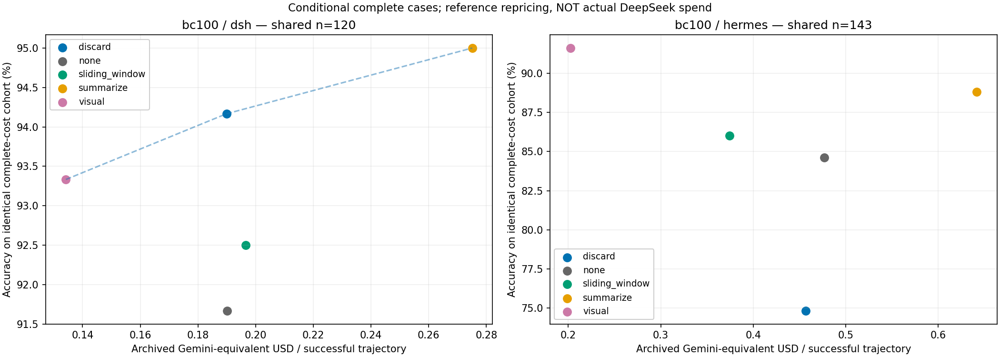
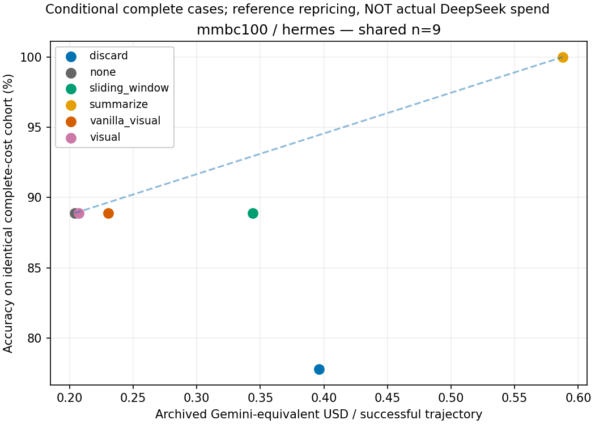
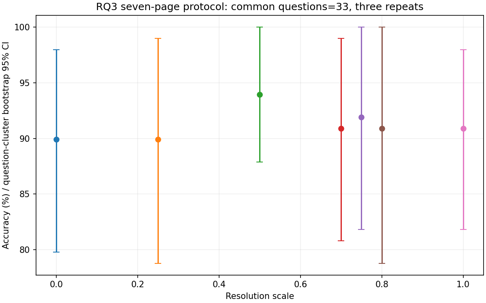

# 成本与缓存冻结表

来源：2026-11-14T14:18:35.211190+00:00。主报告成本未覆盖新增MMBC回补；MMBC共同N=9。各行括号为计量覆盖，不能把不同覆盖的均值相加。超时数量见[总表](README.md#1-当前实测准确率与超时数量)。

仅使用所有方法同时完成、已评分且成功native轨迹usage完整的相同题次，同时计算两个坐标。参考价沿用归档：cached $0.15/M、non-cache $1.50/M、output $9/M；不是实际DeepSeek账单，未重核今日价格。早期失败重试费用保存在原账本，不混入以下成功轨迹效率指标。BC/MMBC接受历史协议混合，结果仅作条件比较。

|Benchmark/Harness|方法|共同N|cached|non-cache|output|total|参考$/题次|Acc%|token cache%|API客户端秒|render秒|E2E秒|压缩次数|
|---|---|---:|---:|---:|---:|---:|---:|---:|---:|---|---|---|---|
|bc100/dsh|discard|120|154055.467|52991.125|9702.733|216749.325|0.190|94.167|74.406|177.669 (4/120)|0.000 (120/120)|646.091 (120/120)|0.525 (120/120)|
|bc100/dsh|none|120|248163.200|50651.983|8549.500|307364.683|0.190|91.667|83.049|124.526 (3/120)|0.000 (120/120)|562.216 (120/120)|0.000 (120/120)|
|bc100/dsh|sliding_window|120|167947.733|63560.733|8452.317|239960.783|0.197|92.500|72.545|170.775 (1/120)|0.000 (120/120)|581.016 (120/120)|1.075 (120/120)|
|bc100/dsh|summarize|120|142394.667|95098.125|12342.133|249834.925|0.275|95.000|59.957|57.632 (2/120)|0.000 (120/120)|568.662 (120/120)|1.450 (120/120)|
|bc100/dsh|visual|120|104406.400|38500.375|6755.167|149661.942|0.134|93.333|73.059|87.562 (8/120)|3.674 (120/120)|498.212 (120/120)|0.275 (120/120)|
|bc100/hermes|discard|143|285312.895|112934.084|27172.175|425419.154|0.457|74.825|71.642|484.586 (1/143)|NA (0/143)|490.675 (143/143)|3.194 (72/143)|
|bc100/hermes|none|143|948394.965|124228.601|16470.210|1089093.776|0.477|84.615|88.418|NA (0/143)|NA (0/143)|383.922 (143/143)|0.000 (143/143)|
|bc100/hermes|sliding_window|143|326066.126|127795.252|14866.105|468727.483|0.374|86.014|71.843|NA (0/143)|NA (0/143)|333.884 (143/143)|8.306 (72/143)|
|bc100/hermes|summarize|143|171101.091|242940.692|27954.881|441996.664|0.642|88.811|41.325|421.170 (1/143)|NA (0/143)|388.365 (143/143)|9.191 (68/143)|
|bc100/hermes|visual|143|129834.965|55264.238|11093.832|196193.035|0.202|91.608|70.143|487.856 (19/143)|17.428 (42/143)|368.405 (143/143)|1.881 (42/143)|
|mmbc100/hermes|discard|9|384241.778|107286.222|19743.333|511271.333|0.396|77.778|78.173|1194.854 (1/9)|NA (0/9)|708.969 (9/9)|4.200 (5/9)|
|mmbc100/hermes|none|9|279822.222|40095.889|11332.111|331250.222|0.204|88.889|87.467|NA (0/9)|NA (0/9)|400.431 (9/9)|0.000 (9/9)|
|mmbc100/hermes|sliding_window|9|318734.222|109214.889|14703.333|442652.444|0.344|88.889|74.479|31.232 (1/9)|NA (0/9)|400.057 (9/9)|15.333 (3/9)|
|mmbc100/hermes|summarize|9|135153.778|246838.333|21906.444|403898.556|0.588|100.000|35.381|196.307 (1/9)|NA (0/9)|472.863 (9/9)|7.250 (4/9)|
|mmbc100/hermes|vanilla_visual|9|222890.667|55156.556|12697.889|290745.111|0.230|88.889|80.163|754.060 (5/9)|25.850 (3/9)|695.064 (9/9)|2.667 (3/9)|
|mmbc100/hermes|visual|9|239800.889|41434.000|12138.556|293373.444|0.207|88.889|85.267|499.198 (5/9)|6.765 (4/9)|641.121 (9/9)|1.500 (4/9)|
|rq3/hermes|scale_0.0|31|86556.903|34797.290|6532.645|127886.839|0.124|90.323|71.326|90.228 (31/31)|4.765 (4/31)|146.007 (31/31)|2.500 (4/31)|
|rq3/hermes|scale_0.25|31|59342.452|23949.355|5803.000|89094.806|0.097|90.323|71.246|60.841 (31/31)|3.003 (3/31)|193.206 (31/31)|1.000 (3/31)|
|rq3/hermes|scale_0.5|31|71163.871|29772.871|5259.226|106195.968|0.103|90.323|70.503|116.087 (31/31)|3.891 (5/31)|247.678 (31/31)|1.200 (5/31)|
|rq3/hermes|scale_0.7|31|84508.903|36221.839|8295.000|129025.742|0.142|90.323|69.998|182.663 (31/31)|7.466 (5/31)|314.915 (31/31)|2.200 (5/31)|
|rq3/hermes|scale_0.75|31|82729.290|27838.226|8985.935|119553.452|0.135|93.548|74.822|117.612 (31/31)|4.383 (3/31)|257.954 (31/31)|1.333 (3/31)|
|rq3/hermes|scale_0.8|31|62121.290|23452.774|6252.839|91826.903|0.101|90.323|72.594|138.734 (31/31)|5.014 (4/31)|249.099 (31/31)|1.250 (4/31)|
|rq3/hermes|scale_1.0|31|68215.742|30321.968|6103.613|104641.323|0.111|93.548|69.228|68.690 (31/31)|5.982 (4/31)|212.714 (31/31)|1.750 (4/31)|

API/render/E2E/压缩列括号为有可靠埋点的题次覆盖，缺失不补0；这些时间可能重叠，不可相加当作独立分解。请求cache hit仅在明确逐请求缓存字段存在时统计，详见JSON selected_execution_metrics。

图中每个面板使用其内部所有方法共同题次；不同面板不共用Pareto前沿。没有完整共同成本子集的面板明确显示不可用。

