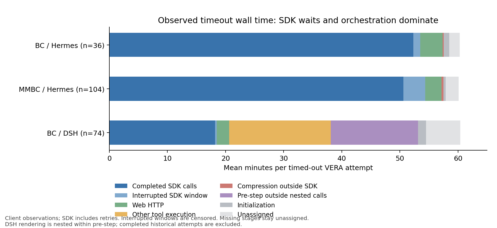

# 视觉超时的阶段分析

离线分析覆盖6900个题次：BC两harness各1500、MMBC1800、RQ3共2100。每槽保留最早合法完成，否则取最新终态，不累计历次retry作为轮数。模型轮数为返回且无记录错误的agent SDK响应数，摘要请求、HTTP渠道重试和多工具调用另计。详细分组见[CSV](stage-groups.csv)。

## MMBC DeepSeek + Hermes

|策略|完成/超时平均轮数|完成/超时每SDK请求均时（秒）|超时/300|
|---|---:|---:|---:|
|No Compression|23.88 / 27.90|38.70 / 129.26|122/300|
|Summarization|22.48 / 30.89|37.80 / 122.78|132/300|
|Sliding Window|25.37 / 32.27|39.48 / 118.99|102/300|
|Discard-All|41.85 / 67.65|34.42 / 104.81|141/300|
|Vanilla Visual|18.53 / 25.16|63.12 / 164.07|132/300|
|VERA|18.67 / 28.99|59.60 / 123.90|104/300|

不同日期/协议混合及完成选择影响上表。限制相同500轮预算后，VERA超时与完成平均轮数差5.02，95%CI[0.63,9.40]，Holm p=0.229；不能称校正后显著轮数膨胀。双方均超时、同题同repeat的67对中，VERA/无压缩平均轮数29.33/31.55，每SDK请求120.46/120.89秒，未显示视觉显著更多轮或更慢请求；这些配对仍跨天。

97条有压缩的MMBC VERA超时轨迹，首次压缩前后成功agent HTTP：

|阶段|压缩前均值秒|压缩后均值秒|
|---|---:|---:|
|上传请求|4.68|27.87|
|上传结束至响应头|41.98|111.09|
|流式正文|6.56|6.73|
|整体HTTP|53.73|146.22|

请求体约1.63→4.97 MB；同实际渠道比较仍有类似增加。增加主要在响应头前等待与上传，正文生成基本不变。局部前后关联不能拆分网关队列、视觉prefill和模型内部计算，也不证明单一因果。

## 跨harness与完整链路

|超时组|已结束SDK窗口|中断SDK窗口|网页HTTP|其他工具执行|非SDK压缩|step前处理|初始化|未归属|
|---|---:|---:|---:|---:|---:|---:|---:|---:|
|MMBC Hermes VERA（104）|3036.4|226.3|165.7|0|19.7|0|23.7|133.1|
|BC Hermes VERA（36）|3139.5|71.4|229.8|0|12.2|0|55.9|108.0|
|BC DSH VERA（74）|1092.3|16.8|128.1|1050.5|0|899.0|84.3|353.2|

每题平均秒数，使用区间并集去重分配；0表示没有分配到该类已知区间，不等于操作绝无开销。SDK包括重试与退避；中断窗口是截止前暴露时间，不是精确provider占用。DSH渲染约8秒嵌套于step前处理，不重复相加。

BC Hermes 视觉首次压缩后，响应头前等待3.32→143.19秒，上传约0→0.54秒；更符合图像请求响应变慢。BC DSH与无压缩同日且双方超时的29配对中，视觉轮数19.07 vs25.45，但SDK均时54.21 vs9.75秒。DSH工具bridge与step前处理也占大量时间，现有计时不能把全部前处理归因于渲染。

104条MMBC视觉超时中7条没有观测到压缩；有个例仅完成1轮、尚未压缩，后续逻辑请求因10次约300秒渠道失败占用3399秒。因此不能将超时统一归因于压缩丢信息、忘记目标或循环搜索。14条人工轨迹检查没有发现足以解释总体的精确工具循环；语义信息丢失仍不能据此排除。

## 优化候选与验证边界

已实现独立的每逻辑SDK请求最多3次物理HTTP发送候选，未部署、未新增付费评测。181个完成中148有埋点、33无埋点；有埋点的3063请求中7个需要第3次发送，未见超过3次的完成请求。104条超时中10条含超过3次发送的请求，超限27次已知耗时共6130秒。这只是离线被截断工作量，不是实测节时或正确率提升；已有一条超时轨迹的某次请求会在第3次以后成功，提前终止可能损失后续机会。

根目录1331项测试通过；效果验证、同协议对照和provider细分计时尚未进行。该候选限制重复失败，不能据此声称解决了响应头前等待的主要瓶颈。

RQ3 0.7的阶段CSV沿用当时已发布98个超时，未发布终态的1槽列入other；当前状态总表经临时结果核实为99个超时。此状态更正不改变其已有阶段时间，也不影响上述MMBC/BC分析。
