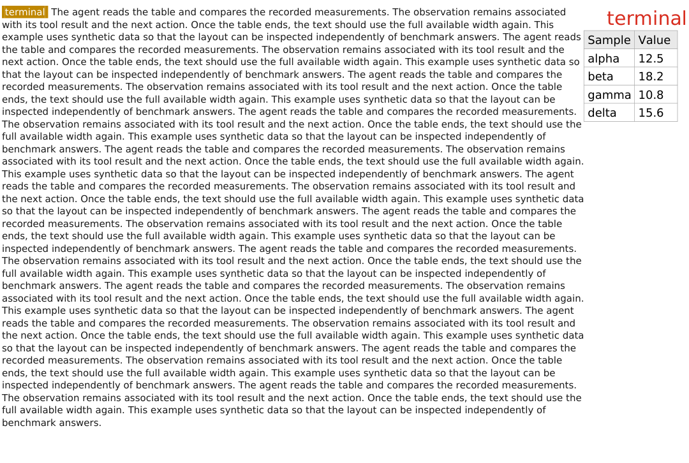
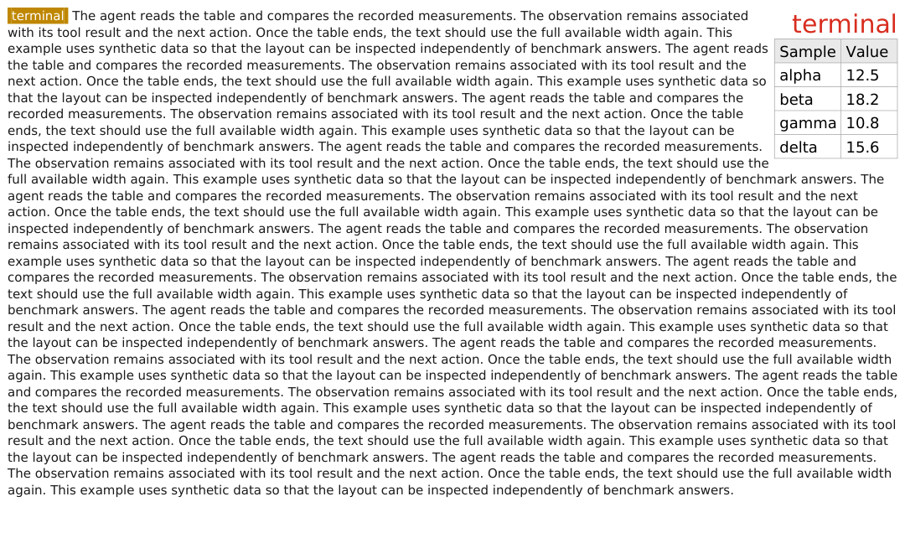
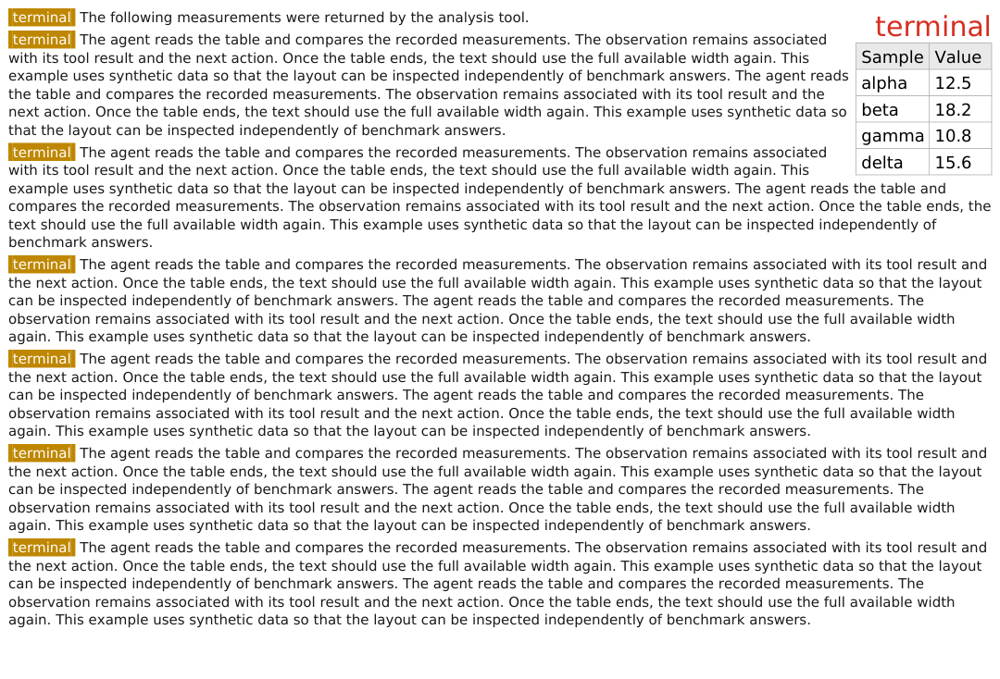
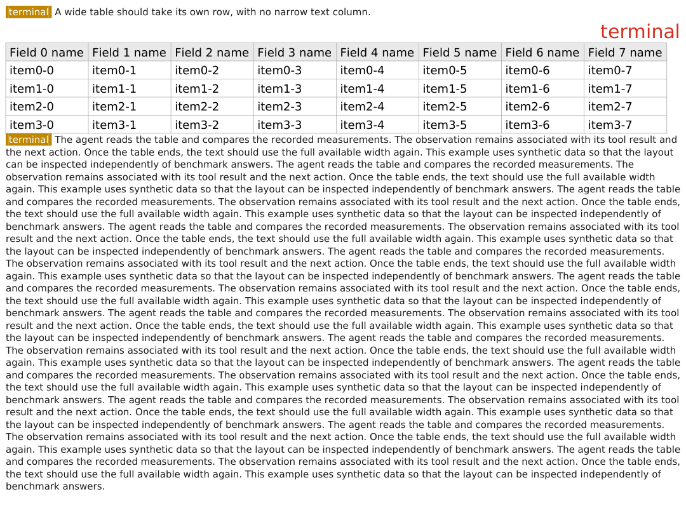
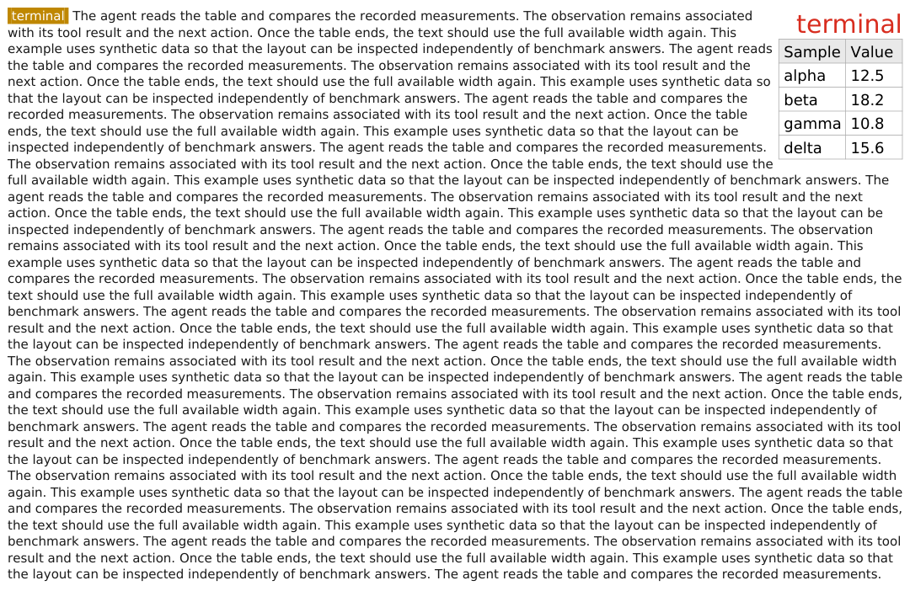
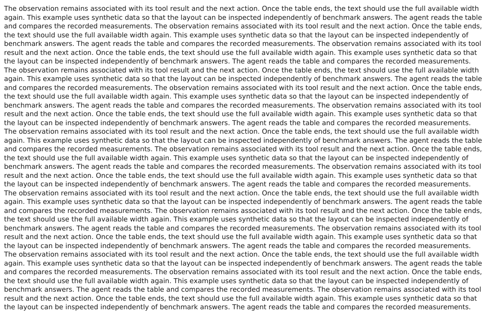
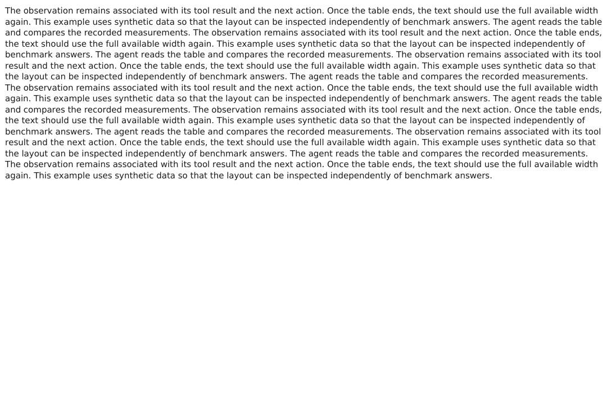

# Table wrapping gallery

These images are actual PDF renders from the visual context engine, using synthetic text and tables. They exercise layout independently of private sessions or benchmark answers. Click an image to inspect it at full size; the PDFs retain selectable text.

## Before / after: one long paragraph

The old layout reserved a fixed left column for the entire paragraph, leaving the area below the table empty. The fixed layout returns to full width below the caption and table.

| Before | After |
|---|---|
|  |  |

[Before PDF](before-single-paragraph.pdf) · [After PDF](single-paragraph.pdf)

## Following message paragraphs

Later messages also fill the space beside the table and resume full width beneath it.



[PDF](following-paragraphs.pdf)

## Wide table

A table that leaves too little room for readable text is placed on its own row. Text then continues at full width.



[PDF](wide-table.pdf)

## Page breaks

This fixture deliberately uses a shorter page height and longer text. The paragraph flows across three pages; the table occurs once, with subsequent pages using the full width.

| Page 1 | Page 2 | Page 3 |
|---|---|---|
|  |  |  |

[Three-page PDF](page-break.pdf)

## Reproduce

From the repository root, after installing ReportLab, PyMuPDF, and Pillow:

```bash
python scripts/render_table_wrap_cases.py
```

Inputs are in [fixtures.json](fixtures.json). The script writes PDFs and one PNG per page. All fixtures use the same font size and page width; the page-break fixture lowers the maximum page height.

The `before-*` files were generated from the working-tree renderer snapshot captured immediately before the fix. That snapshot was not a Git commit. They are retained as comparison artifacts and are not overwritten by the default command. To compare another renderer snapshot with the same input:

```bash
python scripts/render_table_wrap_cases.py \
  --renderer /path/to/render.py \
  --case single-paragraph --prefix comparison-
```

Automated checks in `hermes-agent/tests/agent/test_visual_table_render.py` verify PDF text coordinates, full-width continuation, cross-page text preservation, wide/tall table handling, and tables following images.
