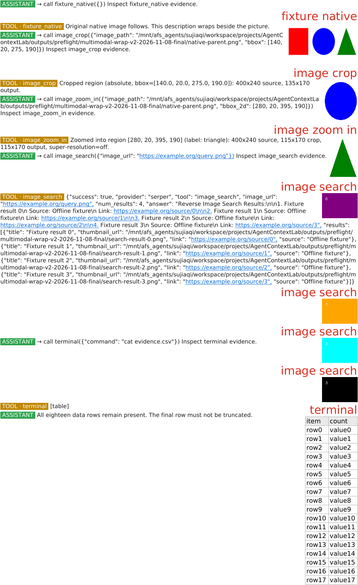

# Render repair preview: multimodal-wrap-v2

This is a review artifact; experiments remain paused. All examples below are synthetic and used zero paid model calls. Original logs/results were not rewritten.

The preview follows the actual Hermes `VisualEngine.compress` path and contains, in source order:

1. The original three-shape image, supplied as inline PNG and as a local file. Identical pixels within the same message are embedded once; both input occurrences remain in the source ledger.
2. An actual `image_crop` result containing the **blue circle**, 135 × 170 pixels. The parent image is not substituted for this crop.
3. An actual `image_zoom_in` result containing the **green triangle**, 115 × 170 pixels. Smart resize and super-resolution were explicitly disabled for this deterministic local fixture.
4. Four image-search result thumbnails, all retained. The actual Hermes `image_search` handler and result formatting ran, with only its HTTP search transport replaced by deterministic local results. These are not real search results or paid provider evidence.
5. A structured table containing all 18 data rows, including `row17`. Text wraps around the right-side images/table.

The input has eight image occurrences; one is an intentional same-pixel duplicate, leaving seven embedded image instances in the PDF. The original source is [native-parent.png](native-parent.png). [manifest.json](manifest.json) records hashes, dimensions, counts and implementation versions without research logs or credentials.

The repair resolves inline `data:` image blocks, native multimodal tool envelopes and actual search-result thumbnails. It removes the prior two-image cap. Crop/zoom assistant arguments no longer cause the parent image to be mistaken for returned evidence. Per-occurrence provenance includes input position, attachment/occurrence identifiers when supplied, decoded pixel hash and deduplication status. Unresolvable/undecodable evidence causes an explicit error instead of silently falling back to text. This is not a claim of semantic losslessness: images still appear as thumbnails inside a rendered canvas.

Table rows and cells are no longer silently truncated to 15 rows or a fixed character length. Ordinary pipe tables are recognized as well as supported structured tool output. Long cells wrap, and tall tables can continue across pages. A message containing both images and a table renders both.

Validation: the canonical Hermes runner passed 16 image/table tests, including four returned-image envelope forms, more than two search results, same-pixel provenance, a 35-row table, missing-image refusal, rasterizer failure refusal, and page/flow wrapping. `scripts/check_multimodal_render_v2.py` additionally ran the actual crop/zoom/search formatting and real PDF rendering; its offline result is under `outputs/preflight/multimodal-wrap-v2-2026-11-08-final/`.

The separate shared-policy adapter uses the actual Hermes discard, sliding-window, summarize and visual engines; `none` disables compression. Ten offline comparisons (five strategies × two successive compressions, with a new Python process per adapter call) produced exactly the same message sequences as retained direct Hermes engine instances. Summary prompts/budgets and second-summary updates match, and visual accumulated histories match after restart. Native DSH surface persistence and final HTTP delivery require their own integration fixtures; Python-level parity alone does not establish those.

Committed validation summaries: [shared-policy-validation.json](shared-policy-validation.json), [pdf-pixel-validation.json](pdf-pixel-validation.json), and [summary-route-validation.json](summary-route-validation.json). The summary fixture exercised the actual Hermes native loop, auxiliary helper and SDK against localhost, including correct separate cached/non-cache/output usage. Nine denial cases sent zero rejected requests to the server, including wrong models/routes, uninstrumented direct HTTP, async inference, and model/endpoint changes by final HTTP request hooks; ordinary web requests still passed. These local fixture token values are synthetic instrumentation checks, not measured experiment costs or model scores.
